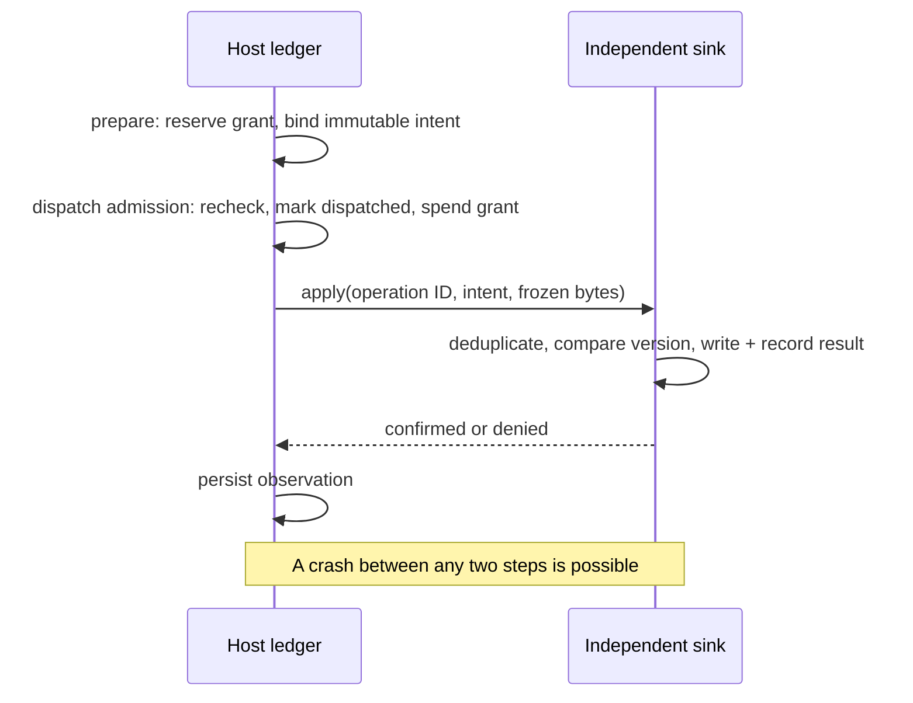

# Accord IR 0.1: executable task contracts

Status: experimental specification and Python reference interpreter, 2026-10-14. This document defines the implemented subset; the [language concept](agent-language-concept.md) describes the larger research direction. No compiler or Agents-Core API is added.

## Remodeling decisions

The initial concept mixed task progress, acceptance validity and external operation state. They now have separate records. A historical acceptance certificate remains evidence about one candidate; **eligibility to act** is recomputed against current dependencies. Cancellation preserves observations of effects that already happened.

The initial phrase “check at the commit boundary” hid two independent systems. The host admits a dispatch in its own transaction; the destination applies a write in another. Host input, policy and cancellation checks are current at admission. Target version checks are current at the destination's write. The prototype does not promise atomic revocation across both databases.

An authorization slot is identified by a host-owned logical request ID. It binds to exactly one intent and one operation. A changed payload cannot get another operation merely by changing a retry UUID. A host can explicitly grant a genuinely new request; the runtime cannot infer whether two natural-language requests mean the same thing.

The prototype narrows acceptance to a conjunction of named checks, output to bounded UTF-8 text, and budget to integer model-request credits. General policy expressions, human decisions, token/currency limits, deadlines, scheduler control flow and compiler syntax remain future work. These omissions are explicit rather than interpreted as permissive defaults.

## Contract wire format

```json
{
  "ir": "accord.contract/0.1",
  "name": "document",
  "inputs": ["spec"],
  "output_max_bytes": 4096,
  "checks": {"nonempty": "1", "mentions_spec": "1"},
  "publish_to": ["report"],
  "request_budget": 3,
  "policy_revision": "p1"
}
```

All fields are required; additional fields and versions are rejected. Resource, check, contract and revision names use `[A-Za-z][A-Za-z0-9_.-]{0,63}`. Input and target arrays contain unique names; empty arrays are allowed. Checks must be nonempty. Output size is 1..65536 UTF-8 bytes; budget is 0..10000 requests. Booleans are not integers. The serialized contract is at most 65536 bytes. Duplicate JSON keys, nonfinite values, floats and invalid Unicode are rejected. Revision strings also allow digit-leading identifiers, such as `1`.

The immutable `Contract` normalizes unordered resource lists and checks. Its revision is a SHA-256 digest over a versioned namespace and canonical UTF-8 JSON: sorted keys, no optional whitespace, Unicode emitted literally, integer numbers only. This is a deliberately restricted Python encoding, not an implementation of RFC 8785. Output digests cover exact UTF-8 bytes. Identifiers are logical resources, not filesystem paths. JSON cannot import Python, define validators, issue grants or activate a policy.

## Durable records

| Record | Identity and binding | Mutability |
|---|---|---|
| Resource | Logical name, monotonic revision, text and digest | Host publishes a new revision; even A → B → A changes identity |
| Profile | Policy revision, environment revision, registered check revisions, activation epoch | Explicit host activation; switching A → B → A advances the epoch |
| Task | Random ID, immutable contract revision, input snapshots, profile/epoch, parent ID | Control state, remaining credits and latest attempt reference change |
| Attempt | Task ID plus caller-supplied attempt label | `started` → `complete` or `failed`; complete output is immutable |
| Check receipt | Host ID, check ID/revision, full candidate binding, Boolean outcome | Immutable |
| Acceptance | Host ID, full binding and selected receipt IDs | Immutable historical certificate |
| Grant | Host logical request ID, exact acceptance and intent | Available → reserved → spent; independent revocation flag |
| Operation | Stable ID derived from grant and intent | Prepared → dispatched → confirmed/denied/unknown |
| Event | Monotonic sequence, kind and record data | Append-only through the public API |

A candidate binding includes task and attempt identity, contract revision, complete declared input manifest (resource revision and content digest), output digest, profile fingerprint and activation epoch. A receipt additionally names its check and validator revision. Each check ID maps to one trusted registered validator; two IDs cannot substitute for each other. No validator configuration language exists in 0.1: configuration changes must bump the validator revision or environment revision.

The ledger is trusted local state, not a cryptographic receipt format. A hash provides identity, not authenticity. Receipt and grant handles resolve only through host-owned records. This assumes callers cannot alter the ledger or invoke privileged host methods without authorization.

## Interpreter operations

| API | Preconditions and durable result |
|---|---|
| `set_resource(name, text)` | Trusted host publishes a new revision. Existing task snapshots are never silently updated. |
| `activate_profile()` | Trusted host explicitly activates its registered revisions. Old runtime instances cannot continue against a different active profile. |
| `create_task(contract, parent=None)` | Snapshot current declared resources and profile. A child has a subset of parent's inputs and targets, no larger output limit, and receives credits transferred atomically from its parent. Parent acceptance requirements do not disappear: consuming a child's result requires the parent's own checks. |
| `infer(task, attempt, model)` | Atomically debit one request before calling the model outside the transaction. Store exact output before returning it. Repeating a completed attempt returns its saved result without calling the model. An unresolved or failed attempt cannot be silently resampled. A new label creates a new charged attempt, even for identical output. |
| `check(task)` | Run registered validators on copies of the frozen snapshot and candidate outside the ledger transaction. Store host-observed receipts. Exceptions/non-Boolean returns produce failed receipts. |
| `accept(task, receipts)` | Require exactly one passed, authentic, matching receipt per required check and current dependencies. Record an immutable acceptance. |
| `authorize(request, task, acceptance, sink, target, expected_version)` | Trusted host binds one logical request to an exact acceptance and intent. Repeating identical parameters returns the same grant; changed parameters conflict. |
| `prepare(task, acceptance, grant)` | Recheck eligibility and authority; reserve the grant and persist one operation. Repeated preparation returns the existing operation. |
| `dispatch(operation)` | Recheck admission guards; atomically mark dispatched and spend authority before calling the sink. Terminal results are replayed; uncertain operations require recovery. |
| `recover(operation)` | Read the sink's recorded result first. Confirmation remains possible after cancellation or invalidation. Resend only the same operation through a deduplicating sink and only after fresh admission. |
| `cancel(task)`, `revoke(grant)` | Block subsequent admissions, including descendants for cancellation. They do not undo already admitted operations. |
| `inspect(kind, id)`, `events()` | Return copies of durable state, including historical outputs and observations. |

There is no untrusted Python execution boundary. Model and validator callbacks are **trusted simulation adapters**; the fake model is deliberately used instead of a paid API. Invalid text consumes the reserved request and marks the attempt failed. A process death after model execution but before recording leaves a charged `started` attempt: the interpreter cannot manufacture a response to replay.

Task control is `active` or `cancelled`; candidate/acceptance are references rather than terminal task states. `needs_input`, `partial`, `failed` task outcomes and automatic scheduling are deferred. Cancellation is terminal in this subset. An acceptance is current only for the latest completed attempt; beginning a new attempt invalidates the previous candidate for new actions without deleting it.

## Transaction and recovery model



1. **Preparation linearizes in the host transaction.** No second payload can bind the same grant.
2. **Admission linearizes in the host transaction.** Cancellation, revocation, dependency/profile changes and remaining authority are checked under the same lock as the transition to dispatched. They may still change after this transaction commits.
3. **Application linearizes in the sink transaction.** The simulated destination deduplicates by operation ID and verifies the intent fingerprint before returning an old result. For a new operation, its target version comparison, text write and outcome record are atomic. A definite CAS rejection records `denied` with no write.
4. **Confirmation linearizes in a later host transaction.** A lost response or process death leaves `dispatched` or `outcome_unknown`, never an invented failure.

SQLite's single-writer serialization and explicit `BEGIN IMMEDIATE` provide the local transaction boundary; they do not supply a transaction spanning the host and sink databases. See [SQLite transactions](https://www.sqlite.org/lang_transaction.html) and [isolation](https://www.sqlite.org/isolation.html). The implementation uses separate connections and explicit transactions supported by Python's [sqlite3 API](https://docs.python.org/3/library/sqlite3.html).

Recovery first looks up the exact operation. A recorded confirmed/denied result is historical evidence and can be recorded even after authority is revoked. A missing record is not proof that a slow original sender cannot still commit. Resending is safe here only because the destination atomically deduplicates the same operation ID and intent, including concurrent submissions. An incapable/opaque adapter leaves the outcome unknown and receives no automatic resend. Failed freshness guards during recovery also preserve unknown: they do not prove non-execution.

A grant stays bound and spent even after a denial, cancellation or process restart. Recovery never changes the operation ID or refreshes authority. A prepared operation that fails admission remains prepared and bound; a previously dispatched uncertain operation stays unknown when a new admission is prohibited. An admitted operation may finish after cancellation; its recorded outcome must not overwrite task cancellation.

## Budget conservation and dependency limits

For a delegation tree, the sum of free task credits and charged attempts equals the root allocation. Child creation moves free credits; it does not copy them. Reservations are charged permanently in this subset, including failed/uncertain model calls. There are no refunds, token estimates, deadline claims or provider-billing guarantees. Concurrent allocation and inference admission use the same durable ledger transactions. Cancelling a parent prevents new descendant admissions but does not reclaim credits.

Only declared inputs and revisioned host profile data participate in freshness. Hidden validator inputs, external changes not published to the registry and adapter implementations changed without revision bumps are outside the contract. A new resource/profile revision requires a new task snapshot and new checks. A new attempt under unchanged dependencies requires new receipts even if output bytes are identical.

## Evaluation and next decision

The [prototype guide](../experiments/accord/README.md) contains runnable commands, actual coverage and limitations. The tests exercise receipt substitution, missing checks, input/profile ABA changes, output identity, concurrent budgets, stable authorization, CAS conflicts, cancellation during dispatch, replay, process death and recovery racing an original sender.

Passing these cases supports the usefulness of the runtime distinctions in this simulator. It does not prove language soundness, task truth, secure containment, arbitrary external exactly-once effects or novelty. Before a compiler, add a second independent interpreter/adapter and a realistic repository workflow, then measure how much bespoke orchestration the contract removes. If portability provides no benefit over a Python library, keep Accord as an IR/library.
