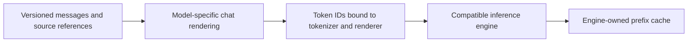

# Accord prompt artifacts and token transport

Token IDs can be prepared once and passed to an inference backend that accepts them. For example, vLLM exposes `TokensPrompt.prompt_token_ids: list[int]`. This is a backend capability verified in its [input API documentation](https://docs.vllm.ai/en/stable/api/vllm/inputs/), not an engine invocation performed by this experiment.

Tokenization encodes input text for a particular vocabulary and configuration. It does not compile an instruction's meaning or provide the model's execution state. A portable exchange should retain messages, roles and source bytes; token IDs can be an optional prepared artifact for a matching destination. Different chat models may require different role/control tokens and templates. Formatting and later tokenization must avoid duplicating special tokens, as described in the [Transformers chat-template guide](https://huggingface.co/docs/transformers/main/en/chat_templating).

## Local probe

The [probe](../experiments/accord/delegation/token_probe.py) encodes the exact 15,456-byte [prepared implementation worker context](../experiments/accord/delegation/fixtures/worker-context.txt). It uses `tokenizers` 0.22.2 and two already cached tokenizer JSON files, with truncation/padding disabled and `add_special_tokens=False`. They belong to Harrier and EmbeddingGemma embedding-model directories. Only tokenizers were loaded; no model weights, chat endpoint or native token-ID delegation was used.

| Representation of this input | Bytes |
|---|---:|
| Original UTF-8 text | 15,456 |
| Compact JSON array of 3,617 IDs | 20,811 |
| IDs as little-endian uint32 | 14,468 |
| Text compressed with zlib level 9 | 6,095 |
| uint32 IDs compressed with zlib level 9 | 5,622 |
| Complete profile-bound JSON packet | 21,565 / 21,572 |

Both profiles restore the exact input bytes, including after JSON packet persistence. Their tokenizer hashes differ, but their ID sequences for this particular input are identical; the tokenizer files differ in added tokens. This does not demonstrate portability across unrelated vocabularies. Compressed sizes are transport measurements for one payload, not inference token savings. The uint32 comparison excludes metadata while the complete packet includes it.

Seven focused checks pass: exact roundtrip, wrong tokenizer profile, wrong render profile, modified IDs, negative ID, unexpected source digest and rehashed wrong text. Profile/ID integrity failures are rejected before decoding; a rehashed different text is rejected after decoding and before return. Hashes bind data to separately trusted expectations; they do not authenticate a sender. [Measurements and fingerprints](../experiments/accord/delegation/results/token-transport.json) and generated packets are retained.

The native worker interface used here accepts a text message. The probe measured the prepared context body, excluding the host wrapper and any hidden chat framing. No token-ID packet was sent to a real subagent. Exact restoration in these two profiles is an observed property, not a promise for every tokenizer or text.

## Real-model follow-up

The [inference evaluation](accord-inference-evaluation.md) now tests direct integer input and actual saved/restored KV state on Qwen3 8B with llama.cpp. It compares the same full prompts across text/ID and cold/warm cache cells, retains every raw response, and separates operational timing from one-time preparation. This follow-up provides inference evidence; the encoding-only measurements above remain a separate historical probe.

## Proposed architecture, not an IR 0.1 extension



Keep three distinct objects:

1. **Portable prompt package:** role/content messages, task/result schema references, source hashes and explicit asset dependencies. A parent and child can exchange a content address plus changed task data if both are authorized to resolve the referenced assets. A hash alone neither transfers the bytes nor grants access.
2. **Prepared token artifact:** the complete rendered prompt's digest, tokenizer artifact/version, chat-template and tool-renderer digests, special-token/generation-prompt options, token IDs and their encoding/hash. A consumer uses it only under a matching supported profile; otherwise it regenerates from the portable messages. Do not assume independently tokenized fragments can be concatenated to reproduce tokenization of the full rendered prompt.
3. **Optional cache handle:** an engine-owned reference with its own compatibility, tenancy and lifetime rules. It is an optimization hint rather than the portable meaning of the assignment. A cache miss must preserve correct execution from messages/tokens.

The executable probe implements a much smaller integrity-bound packet for already-rendered plain text. It does not implement chat rendering, asset resolution, access control, engine handoff or a KV-cache protocol. The proposal should remain separate until an engine experiment validates those boundaries.

Preparing IDs may avoid repeated tokenizer work when the backend supports direct input, but the model still needs to process the sequence. Reusing prior model computation requires a separate mechanism: vLLM's automatic prefix caching reuses KV cache for a shared prefix and reduces prefill work, while it does not accelerate new-token decoding. See [vLLM automatic prefix caching](https://docs.vllm.ai/en/stable/features/automatic_prefix_caching/). The current probe measured none of these inference effects.

For Accord, the useful hypothesis is a versioned prompt package with optional backend artifacts and cache references. Python can build it; there is no demonstrated need for a custom language. The [real-model follow-up](accord-inference-evaluation.md) implements that comparison in ordinary Python. It keeps prepared inputs and cache metadata outside IR 0.1; backend optimization does not require new language syntax.

## Reproduce

With `tokenizers` installed, run from the worktree root:

```sh
python -m experiments.accord.delegation.token_probe \
  --input experiments/accord/delegation/fixtures/worker-context.txt \
  --output /tmp/accord-token-transport.json \
  --profile first=/absolute/path/to/first/tokenizer.json \
  --profile second=/absolute/path/to/second/tokenizer.json
```

The local defaults identify the two cached files used for the recorded run. Other files require explicit profile paths and may not reconstruct this text exactly; the probe fails rather than silently accepting changed source bytes. It downloads nothing. Source and checks are experimental trusted code, not a hardened network receiver.
