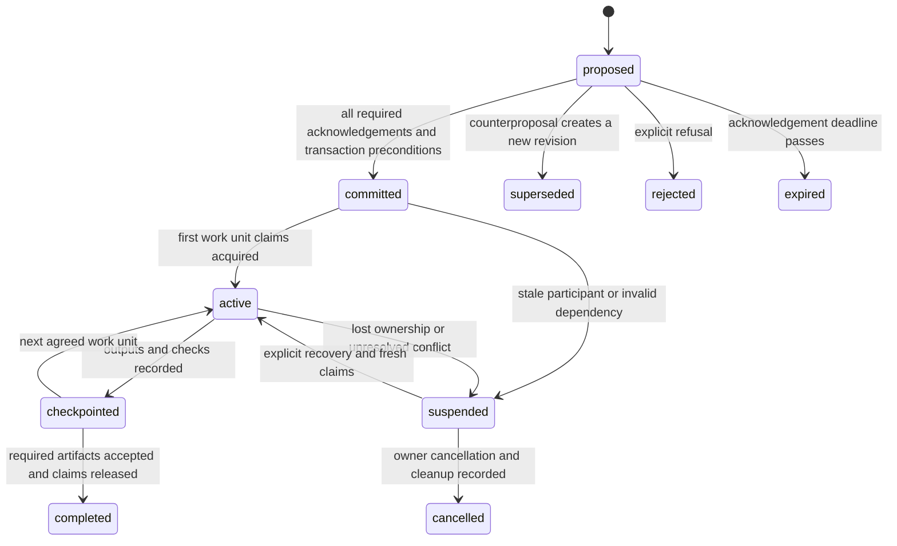

# Cooperation protocol

Status: **design and acceptance contract for the implementation**. The
[delivery record](README.md) distinguishes implemented behavior, executed checks
and remaining limitations; requirements below are not evidence of passing tests.
Version: `agents-core/cooperation/1`. “Must” below is an acceptance requirement.
This sidecar does not change persona protocol 2 or `agents-core/subagent/1`.

## 1. Authority and operating boundary

A participant is an execution instance, not a persona. Two workers using the same persona are distinct participants. A root controls its own delegated assignments; it does not control an independent root's user request. The journal enforces metadata invariants, while the host enforces tool access and actual execution.

The MVP supports cooperating sessions under one trusted OS user and one Agents-Core installation on one machine. It is not a hostile-tenant security boundary. Each caller must already be permitted to access the repository and use the communication channel. Reading a discovered chat does not authorize messaging it. Cross-chat messages require the host's normal user authorization; the journal cannot bypass it. Receiving a peer request cannot authorize a reply through a restricted channel.

Mutations must be authenticated to the registered participant capability. A bare participant ID, role, task hash or contract fingerprint is never proof of identity. Per-participant opaque capabilities are returned once, stored by the host/session, and redacted from journal events, artifacts, summaries and logs. The server stores only a verifier. Child capabilities are created by the registered parent and limited to its nominated child/scopes; the parent does not distribute its own capability. No claim can expand workspace or action permissions. These capabilities reduce accidental impersonation; a process with unrestricted access to the same user's private files remains outside the trust boundary.

Without a safe capability store/channel, a parent relays child coordination under its own identity and records the child as the subject. Do not pretend the child independently acknowledged. A parent may approve assignment sequencing for its own workers but may not acknowledge on behalf of an independent root.

Authorized participants may communicate through the service's durable MCP mailbox. This uses the same installed authority across compatible AI clients and model providers, including the existing stdio-to-HTTP bridge; no native host messaging tool is required. The protocol does not launch or wake models, call provider APIs, or authorize unrelated cross-chat contact. A peer message is untrusted task evidence, not a new instruction hierarchy or permission grant.

## 2. Identity and discovery

Register the following separately:

| Field | Meaning |
|---|---|
| `repository_id` | Server-derived identity of canonical Git common directory in the current service installation |
| `workspace_id` | Existing verified access context; not necessarily the actual worktree |
| `checkout_id` | Server-derived identity of the canonical physical checkout root |
| `participant_id` | Fresh execution instance ID; role name is optional descriptive metadata |
| `root_task_id`, `task_id`, `attempt_id` | Assignment identity; parent/root links explicit |
| `contract_revision` | Original worker contract fingerprint when present, otherwise null |
| `base_commit`, `branch` | Observed checkout revision and branch; informational, not authority |
| `generation` | Server-issued epoch changed on participant recovery/replacement |
| `capabilities` | Supported protocol version, communication mode, artifact access and execution mode |

Resolve paths through existing workspace access rules first. Derive repository membership with bounded Git commands, including `git rev-parse --git-common-dir` and `--show-toplevel`, against the verified checkout. Resolve aliases before comparing identities. Case-insensitive filesystem aliases must collide; do not lowercase every path on case-sensitive filesystems. An unresolvable identity returns an error. Git remote URL equality must not join repositories. Independent clones and submodules are distinct domains in v1; no silent cross-host identity.

Do not use `_main_checkout` memory canonicalization as the checkout identity. Reject traversal, escaping symlinks and unknown resource types. Do not read artifact URLs or paths during registration or shape validation.

Before planned mutations, native spawning or broad tests, a participant checks active tasks/claims for its repository. Recheck when the planned scope grows, after resuming, when a peer notification arrives and before integration. Dirty files/worktrees are supplementary collision evidence, not a way to infer another agent's intent or permission. The journal can discover only registered participants. Unknown owners trigger conservative isolation or an owner decision, not automatic takeover.

## 3. Resource model and conflict rules

A claim names `resource_type`, `resource_key`, `access`, `participant_id`, `generation`, `agreement_id` when applicable, and a server revision. Claims are complete sets for the next bounded work unit, not unlimited “whole repository” reservations.

| Resource | Key and collision rule |
|---|---|
| Physical file or subtree | `checkout_id + normalized relative path`; equal paths or ancestor/descendant subtrees overlap |
| Logical change intent | `repository_id + module/API/task key`; reports semantic overlap across worktrees; negotiable, does not forbid independent private edits |
| Integration target | `repository_id + target branch/ref`; one integrating writer |
| Shared Git state | `repository_id + refs/config/maintenance category`; exclusive for mutating operations |
| Heavy execution slot | Explicit host/installation resource; adapter checks the existing heavy-process lease before execution |

Access modes are `snapshot_read`, `write` and `integrate`. Immutable revision reads do not conflict. A live checkout read during a writer is allowed only as potentially stale evidence; it cannot support a final test/verification claim without a pinned revision. Two writers to overlapping physical paths conflict. Read-only review at a pinned commit can run alongside unrelated writes.

Default independent roots to separate worktrees. Workers sharing a checkout may edit only disjoint claimed paths. For the same file, v1 uses one writer; do not claim hunk-level independence. Generated files, lockfiles, migrations and shared fixtures must be included in declared scope. An integration target claim coordinates merge order but does not grant merge/push permission.

Acquire all physical/shared resource claims for a work unit in one transaction. A failed request acquires none. Do not hold resource A while waiting to acquire B. A task may reserve only its current ready work unit; release unnecessary claims before dependency waits. Existing held work is non-preemptive until a safe checkpoint.

## 4. Cooperation patterns

| Pattern | Trigger | Agreement and exit |
|---|---|---|
| Inform and reuse | Same fact/evidence is useful to another task | Pin revision/hash, limitations and relevance; consumer verifies before relying on it; no ownership transfer |
| Partition and join | Scope can be divided | Disjoint owners, output contract, common base, one integrator; join after validation |
| Producer-consumer pipeline | B needs A's interface/artifact | Dependency with artifact name/version and acceptance conditions; B starts dependent work only after acceptance |
| Single writer with reviewers | Same file/API needs several perspectives | One writer; reviewers use pinned snapshots and report proposals rather than apply changes |
| Handoff | Ownership or expertise must move | Old owner checkpoints and releases, new owner accepts exact artifact/scope, service transfers claim atomically |
| Duplicate-work adoption | Two tasks pursue materially the same result | Compare requirements; choose producer, verifier or explicit cancellation by each task owner; never silently close another task |
| Bounded dispute | Requirements/priorities cannot be reconciled | One counterproposal per party, then owner decision or isolated work; no majority vote overrides a user's constraint |

All patterns name participants, owned resources, dependencies, expected artifacts, integrator, priority source, checkpoint and termination condition. Do not instantiate negotiation for unrelated read-only work.

## 5. Negotiation and agreement lifecycle

An agreement has immutable proposal revisions. State machine:

“Committed” means a recorded agreement, not Git commit or permission to mutate. Each bounded work unit still needs successful claim acquisition. “Completed” describes cooperation obligations, not automatic completion of a worker/user task.

1. The discoverer records the conflicting resources and relevant evidence, and proposes a pattern and terms.
2. Each required participant acknowledges the exact proposal revision and terms digest, rejects with a reason, or counterproposes. A counterproposal supersedes the old revision and clears all acknowledgements.
3. The final acknowledgement commits only if the expected journal revision, participant generations, permissions, dependencies and competing commitments still match. Check and write agreement/events atomically. On conflict return current revisions, not a partial commitment.
4. The service checks resource compatibility again when a work unit acquires claims. A newly registered conflicting task does not revoke existing claims.
5. Participants exchange changed assumptions and checkpoint artifacts; re-negotiate if scope, required output or sequence changes.
6. Handoff uses a release-ready checkpoint from the old owner plus acceptance from the new owner, with transfer in one transaction. Never allow two owners during transfer.
7. Each root/parent validates its own delegated result with its original contract and assesses evidence. The agreed integrator checks cross-task compatibility before applying artifacts in its authorized checkout.

Default negotiation cap: initial proposal plus one counterproposal from each required party, at most three proposal revisions for two-party negotiation. Maximum required participants per agreement: eight; larger work is partitioned. Proposed acknowledgement deadline: 120 seconds. These are design defaults, not measured model performance. A waiting agent can work elsewhere. Expiry means no agreement; the caller reports the unresolved overlap once and avoids repeated unsolicited proposals.

## 6. Ordering, priority and fairness

Permissions and correctness preconditions are gates, never priority scores. First honor user stop/cancel instructions, then dependency readiness and valid claims. Cancellation suspends admission of new work; host cancellation and evidence of stopped work govern actual process cleanup.

Keep the current non-preemptible work unit until it finishes or reaches an explicitly agreed checkpoint. For queued work, compute one effective priority before comparison. Use numeric ranks only internally: background=0, normal=1, urgent=2.

- Base priority comes from the explicit authorized user instruction, otherwise normal.
- Aging promotion is computed from base priority, never from a previously inherited value: `aged = min(2, base + floor(ready_wait_seconds / 600))`. Count only time eligible and waiting for resources; pause the clock while dependency-blocked or running. Preserve accumulated eligible wait across transient rechecks, not across completed work units/new attempts.
- Dependency inheritance flows backward through the accepted acyclic dependency graph: `effective(task) = max(aged(task), effective(each unfinished dependent))`. Compute in reverse topological order. Blocked dependents can transmit their authorized/previously aged urgency but do not age while blocked. Remove an inherited contribution when that dependency is accepted, cancelled or removed; recompute from current facts, never retain a sticky inherited rank.
- Among ready work units, sort by descending effective priority, then ascending server-assigned ready sequence, then task ID in bytewise order. Base priority is not a separate earlier sort key. For equal effective urgency, an older ready prerequisite/aged task precedes newer ordinary work.

This formula intentionally allows a background task to reach urgent after twenty minutes of eligible waiting and an urgent consumer's ready prerequisite to outrank unrelated normal work. The ten-minute step and rank values are proposed policy defaults, not measured service guarantees.

Persist the priority source and each inherited/aged adjustment. Agents cannot promote themselves by calling a task urgent. Cross-root priority provenance that cannot be verified is an assertion: request agreement or treat it as normal. Conflicting explicit user orders cannot be resolved by agent rank, persona name, token usage or model confidence.

Every work unit declares a checkpoint event and a maximum expected interval (default five minutes). If exceeded, stop extending the reservation and request a checkpoint; do not revoke live ownership and grant a competitor. This makes starvation visible but cannot guarantee wall-clock fairness against a noncooperating process.

Represent dependencies as a directed acyclic graph of task attempts/artifact acceptance gates. Reject a new edge if it creates a cycle. If a cycle is discovered during reconciliation, freeze only the affected component and return a concrete cycle path to the owners; release unneeded claims. Reprioritization cannot make a cyclic dependency ready.

## 7. API and data contract

The implementation exposes nine MCP tools with strict internal schemas and client-compatible input declarations. The original three coordination tools were absent at the recorded research baseline; the mailbox, notification waits and request tracking extend that implementation. The service is disabled by default (`AGENTS_COOPERATION_ENABLED=0`). The installed daemon is the only service authority. Direct HTTP and the existing `bridge/stdio.mjs` reach that authority; standalone stdio without forwarding returns `store_unavailable`.

| Tool | Request | Result |
|---|---|---|
| `cooperation_register` | Verified `workspace`, actual `checkout_path`, task/attempt/parent identity, supported version, bounded scope and communication mode | Domain/participant identity, generation, private capability or parent-relay mode, current revision and protocol guidance |
| `cooperation_read` | Verified workspace, repository identity, bounded filters, optional event cursor, limit, offset and snapshot time | Consistent snapshot plus ordered events and next cursor; repeat the first page's `snapshot_time` and verify unchanged revision/epoch across pages; no capability secrets |
| `cooperation_apply` | Verified workspace, participant capability, `operation_id`, expected revision/generation, typed action | Committed event/revision or a typed error with authoritative current state |
| `cooperation_send` | Verified workspace, participant capability, `operation_id`, recipient, kind, body, optional reply/correlation references and child subject | Persisted private message or a typed error |
| `cooperation_receive` | Verified workspace, participant capability, optional child subject, inbox cursor/limit and acknowledged filter | Non-destructive inbox page, next cursor and more-results flag |
| `cooperation_ack` | Verified workspace, participant capability, `operation_id`, optional child subject and unique inbox message IDs | Durable delivery acknowledgement or a typed error |
| `cooperation_wait` | Mailbox authentication, notification cursor, limit and timeout of 0–30 seconds | Durable private event page, next cursor, more-results/timeout flags and service epoch |
| `cooperation_request_status` | Mailbox authentication and request message ID | Current delivery and processing record for either authorized party |
| `cooperation_request_update` | Mailbox authentication, operation ID, request message ID, current request revision and explicit processing state | Atomically recorded outcome and private notifications, or a typed error |

Actions are a closed discriminated union: `declare_intent`, `propose`, `acknowledge`, `reject`, `acquire`, `heartbeat`, `checkpoint`, `release`, `handoff`, `accept_artifact`, `cancel`, `recover`. Each action has a dedicated schema; no arbitrary dictionaries that mutate database fields. `declare_intent` records task dependencies and requested priority, with authority/provenance checks. `propose` creates or supersedes a proposal, with an explicit prior proposal reference.

An event envelope contains exactly: `protocol`, `event_id`, `operation_id`, `repository_id`, `revision`, `actor_id`, `subject_id` (nullable for parent relay), `task_id`, `attempt_id`, `generation`, `kind`, `agreement_id` (nullable), `proposal_revision` (nullable), `reply_to` (nullable), `created_at` and a typed `payload`. The service sets event ID, revision, actor and time. Never trust client timestamps for ordering.

For `cooperation_apply`, store the tuple (repository, participant, operation_id) uniquely with canonical request digest and result in the action-receipt namespace. The mailbox has its own shared send/ack receipt namespace. Retry of the same ID and identical body returns its original result, even after the revision advances. Reusing it with another body in the same namespace returns `idempotency_conflict`. After an ambiguous timeout, read/retry the same operation; never invent a new ID to “try again”.

Errors include `unsupported_version`, `workspace_required`, `workspace_invalid`, `unauthorized_actor`, `scope_denied`, `stale_revision`, `stale_generation`, `claim_conflict`, `dependency_cycle`, `proposal_expired`, `idempotency_conflict`, `mailbox_full`, `busy`, `cursor_expired` and `store_unavailable`. Errors must not leak peer capabilities, messages or unauthorized artifacts. Invalid/unknown fields have no side effects.

Proposed bounds: 32 KiB UTF-8 per request/event; 4,000 characters per text; 50 scope/dependency/evidence items; eight agreement participants; maximum depth 8; read limit default 50 and maximum 100. Reject duplicate keys, non-finite numbers, booleans as integers and unknown fields. Do not confuse byte limits with worker character budgets.

Retain terminal agreement events and action idempotency receipts for 30 days after terminalization; never collect receipts or events for active/nonterminal agreements. Tombstone participant IDs/generations to prevent identity reuse. Public read returns a minimum available cursor; an older cursor gets `cursor_expired` and requires a new snapshot. Keep retention configurable by the owner, not by peers. Mailbox messages and their private send/ack receipts are retained separately without automatic deletion, including after acknowledgement; do not claim the agreement-retention window limits mailbox storage.

## 8. Information exchange

Registration defaults to `communication_mode="mcp"`; `native`, `parent_relay` and `checkpoint` remain supported. Each mailbox request carries the protocol, repository ID, actor participant ID and private capability. Optional `subject_id` is restricted to the actor's direct registered child with `parent_relay` communication mode. The returned message preserves effective sender and recipient plus the actual actor. Only the authenticated inbox owner or that authorized relay may receive or acknowledge delivery.

Send accepts `kind` of `notice` (default), `request` or `response`, a nonblank body of at most 4,000 characters, optional `correlation_id` and optional `reply_to`. A reply reverses the original message's sender/recipient pair. The service assigns message ID, cursor and creation time. Success proves durable storage, not receipt by a model. The recipient polls with `cooperation_receive`, handles the message and acknowledges with `cooperation_ack`; it can then send a response referencing the original message. A reply does not itself replace delivery acknowledgement.

Receive defaults to pending messages, `after_cursor=0`, `limit=20` (1–50), and `include_acknowledged=false`. It returns `messages`, `next_cursor` and `has_more` without consuming delivery. The cursor pages messages within a poll; a new poll from zero retries any unacknowledged earlier messages. With `include_acknowledged=true`, retained acknowledged messages are also visible. Ack accepts 1–50 unique message IDs belonging to the recipient. Send and ack share persistent private idempotency receipts in a namespace separate from `cooperation_apply`. Identical retries return the original response across restart; a changed payload or operation kind under the same mailbox actor/operation ID fails.

Message bodies and private receipts must not appear in public snapshots or events. The mailbox is private within the participant API, under the same trusted local OS account boundary as the rest of the service. Pending deliveries are capped at 1,000 per recipient; further sends return `mailbox_full` until deliveries are acknowledged. Messages and private receipts have no automatic retention cleanup.

Mailbox delivery acknowledgement is distinct from `cooperation_apply` agreement acknowledgement and artifact acceptance. It grants no permissions or resource claims and does not validate a worker result. Mailbox calls do not require revision/generation fields, renew heartbeats, clear suspicion/quarantine or admit work. Successful polling records registration usage to prevent unused-record retirement, without asserting execution liveness. Suspect participants can communicate to reconcile; cancelled participants with still-valid capabilities may receive and acknowledge but may not send new messages. New sends to cancelled recipients are refused. Bound polling and use useful checkpoints: there is no push wakeup or guaranteed autonomous response.

A useful message contains: what changed; which task/resource/artifact it affects; exact revision or digest; evidence and limitations; the requested response; and the next checkpoint. Send only meaningful state changes. No periodic “still working” narrative when nothing changed. Heartbeats are service metadata, not user notifications.

The [runtime request-tracking contract](runtime.md#request-tracking-and-event-waits) specifies private durable events, request states, deadlines and allowed transitions. Optional request `expires_at` is a future Unix timestamp. Processing updates require a per-request revision, independently of public-journal revisions. Delivery acknowledgement, declared processing completion and validated work acceptance remain distinct. `cooperation_wait` completes an active asynchronous call; a host adapter is still required to wake an idle model. Schema version 4 preserves legacy send/ack operation fingerprints and backfills historical requests conservatively without inventing completion or historical notifications.

Artifacts contain an ID, producer task/attempt, repository and base/head revision, relative path or approved URI, digest, media/type, summary, checks with actual outcomes, limitations and acceptance conditions. A reference is not fetched automatically. The consumer checks accessibility and revision/hash before acceptance; mismatches block only dependent work. Never transmit credentials, full private transcripts, hidden reasoning, environment dumps or unrelated user information.

Record reusable implementation patterns as evidence cards: name, context, applicable conditions, observed solution, source revision, validation status and limitations. They are local task evidence, not new global policy or instructions. Adoption into permanent rules needs a separate explicit change/review.

## 9. Liveness and recovery

Heartbeat default: every 30 seconds through a host-supported background mechanism or the next checkpoint. Soft-stale threshold: 120 seconds. A model blocked in a long tool call may miss heartbeats; staleness is suspicion only. The service records `suspect`, rejects new work/renewals under stale generations and suspends dependent admission, but keeps held claims quarantined.

No automatic claim stealing after TTL. Recovery requires explicit release/acknowledged handoff or host evidence that the execution stopped, followed by inspection of its actual checkpoint/dirty state. Without such evidence, continue in an isolated worktree and request the specific ownership decision. The service never kills a process, resets files or deletes another worktree.

On service restart, increment a persisted service epoch, mark prior live participants suspect and require recovery. Recovery issues a new generation after owner authentication and state reconciliation; old-generation mutations fail. Keep claims quarantined until their owner is safely reconciled. A lost capability cannot be reconstructed from public identifiers. A registered parent's own still-valid capability can recover only its registered children, after the same execution/checkpoint reconciliation; it cannot recover an independent root.

Independent-root lost-capability recovery is **not an online MCP operation in v1**. Define an owner-only offline administrative cleanup command in W2/W3. It is explicitly invoked or authorized by the human installation owner, runs as the verified OS owner of private service state, and requires the coordinator to be stopped with its administration lock held. It refuses cleanup until the named execution is confirmed stopped and its dirty/checkpoint state has been inspected; an unverifiable process state remains quarantined. The owner supplies the exact repository/participant identity, expected claim revisions and a reason. One transaction records the owner cleanup audit event, cancels that participant, invalidates its credentials and releases only the enumerated claims. It never changes worktree files, resets the whole database, resurrects the old participant or grants a replacement claim. Restart advances the epoch; the replacement root registers afresh and all survivors reconcile.

The shared daemon bearer token, public task/participant IDs, a peer assertion or a recomputed fingerprint cannot invoke this cleanup. It is not exposed through cooperation_apply, and an agent cannot infer permission to run it from a timeout. The administrative authority is the local installation owner plus explicit authorization, not another agent's priority. This remains the stated trusted-account boundary: it does not defend against a malicious unrestricted process running as that OS owner.

If registration's response is lost before the caller receives its capability, no resource claims can exist for that unbound registration. Register a fresh instance rather than guessing its credential; retire the inert record through retention. Do not apply this exception to an established participant that may hold claims.

SQLite protects metadata within transactions. It cannot fence direct filesystem writes between a claim check and a shell operation. Thus this protocol guarantees journal consistency for participating clients, not perfect prevention of edits by stalled or unregistered agents. Host adapters may later enforce writes, but must be tested separately and must not be implied by v1.

## 10. Degraded operation

If the service is unavailable, a parent can coordinate its own workers through an authorized native channel, preserving one writer and all worker result contracts. Independent roots use separate worktrees and avoid shared integration/ref operations until an owner can resolve the overlap. If no channel exists, return the existing `input_required` or `partial` envelope with the exact dependency to the parent; an ordinary root reports the material limitation to its user. Do not poll indefinitely, fake acknowledgement, claim new tools exist or treat failure as permission.
