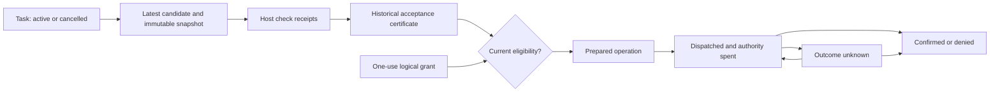

# Accord: a contract language for agent work

Status: research concept with an experimental [IR 0.1](accord-ir.md) and [Python interpreter](../experiments/accord/README.md), 2026-10-14. No compiler or new Agents-Core API is implemented. Accord is a working name; naming and trademark availability have not been checked.

## Design decision

The promising gap is a portable language for **assigning work, deciding whether its result satisfies a contract, and connecting that decision to an authorized action on the same artifact revision**. Build a small contract language and intermediate representation first, with Python and TypeScript adapters. A standalone general-purpose language would be a later decision.

This is a differentiation hypothesis, not a claim that nobody has implemented these ideas. [ETAS](https://arxiv.org/abs/2607.17780) already combines inference, typed effects, policies, approvals and traces. [LBAC](https://arxiv.org/abs/2605.12863) addresses provenance and constrained subagents. [CapLease](https://arxiv.org/abs/2608.01710) addresses durable authorization and semantic replay. Accord should reuse these foundations and test whether explicit task acceptance and dependency invalidation provide a useful additional abstraction. The [landscape survey](agent-language-landscape.md) identifies the closest work and its maturity.

The unit of programming is a **task contract**, not a prompt. Its input is a revisioned snapshot; its output is a typed outcome; its completion condition names executable validators or an explicit human decision; its effects name the authority needed to act. Models may select strategies within that boundary.

## User and first use case

The intended user is a developer delegating repository work to several AI workers. They need an inspectable statement of what was requested, which checks actually ran, which bytes were accepted, and which operation is permitted next. The interaction is instrumental and collaborative: a CLI or editor presents the contract, diff, check receipts and pending decision. Routine actions can proceed under a previously granted policy; a task requests human input only where its contract requires a human decision or critical information is missing.

Start with a narrow workflow: one worker proposes a documentation change in an isolated worktree; a trusted host checks the exact diff and its declared acceptance conditions; a granted action records or publishes that exact revision. The model may plan, inspect, revise and ask for missing input. Acceptance and authority remain host decisions.

A typical failure today is that a worker reports “checks passed,” changes the artifact afterward, and the parent publishes the new bytes using the old report. Another is that a valid JSON envelope is treated as proof that the task is complete. Accord makes both distinctions visible in the program.

## Core values and boundaries

| Value | Meaning | What it does not establish |
|---|---|---|
| `Snapshot<T>` | Input bytes or external resource version, source identity and dependency manifest | That the source is accurate or remains current |
| `Candidate<T>` | A schema-conforming model or worker output, with its attempt identity | Truth, completion or authority |
| `Evidence` | A source reference or host-observed check receipt, with origin and revisions | A claim is true just because it has a citation |
| `Checked<T, V>` | The named trusted validator `V` accepted these bytes against these inputs | Universal correctness or approval to publish |
| `Accepted<C>` | The contract's required checks and decisions were satisfied for one dependency manifest | Ongoing validity after a dependency changes |
| `Grant<A>` | Host-held authority for action `A`, bounded by principal, resource and policy | That a candidate result is acceptable |
| `ActionIntent<A>` | Canonical description of the intended external operation and its payload | That the operation ran |
| `ActionReceipt<A>` | Host-observed confirmed outcome, or an explicit unresolved outcome | Exactly-once behavior for arbitrary remote APIs |

All type and keyword names here are proposed syntax. Opaque receipts and grants are issued by the trusted host, cannot be constructed from model text, and cannot be cast from ordinary JSON. Receipt authenticity is separate from content addressing: a hash identifies content; a hash alone does not authenticate a worker or validator.

A receipt binds the task and attempt, contract revision, input manifest, output digest, validator identity and revision, environment assumptions, policy revision, and observed outcome. `Accepted<C>` is relative to those checks. A deterministic validator can be incomplete or wrong. A model reviewer contributes another `Candidate<Review>`; it does not issue a trusted check receipt by saying “passed.”

## Proposed surface language

This example is illustrative and not executable. Named adapters, helper functions and validators below are hypothetical interfaces to be designed, not existing Agents-Core APIs.

```text
contract DocumentationChange(input: Snapshot<Repository>) {
  output: Candidate<Patch>
  outcomes: accepted | rejected | partial | needs_input | failed | cancelled

  scope: worktree(input)
  effects: [repo.read, worktree.write, model.infer]
  budget: { attempts: 3, model_tokens: 24000, deadline: 20m }

  accept using trusted_host {
    check patch_is_inside_scope(output, input)
    check declared_documentation_checks(output, input)
    check all_required_checks_passed_on(output.digest, input.manifest)
  }
}

flow update_docs(base: Snapshot<Repository>, grant: Grant<RecordChange>) {
  // The host reserves a slice of this task's authority and budget.
  let result = delegate editor with DocumentationChange(base)

  match result {
    candidate(patch) => {
      let accepted = accept patch against DocumentationChange(base)
        else return rejected(diagnostics)

      let intent = prepare RecordChange(accepted.output_digest)
        requires accepted
        requires grant
        freshness base.manifest

      return commit intent
        recovery reconcile_before_retry
    }
    partial(work, remaining) => return partial(work, remaining)
    needs_input(question) => return needs_input(question)
    failed(reason) => return failed(reason)
    cancelled => return cancelled
  }
}
```

The worker's returned candidate is an internal execution event; only the host can transition the task to `accepted`. An edit made after acceptance changes the digest and requires fresh acceptance. `RecordChange` resolves a content-addressed patch or immutable tree; it never re-reads an unconstrained path to obtain different bytes at commit time. Where current target state matters, the adapter must atomically compare its expected version with the write or use a remote precondition. If that guarantee is unavailable, the contract must disclose the weaker guarantee and cannot claim atomic freshness.

A useful diagnostic should explain the violated contract, for example: “Publication requires checks for digest D2; the supplied receipts cover D1.” It should not dump the model transcript.

## Minimal semantics

The broader proposed core has eight operations: `snapshot`, `infer`, `delegate`, `check`, `accept`, `prepare`, `commit`, and `await_input`. Pure host-language computation remains ordinary Python or TypeScript. Model-selected tool calls enter the same mediated effect boundary as calls written by the developer.

1. `infer` validates output shape and returns a candidate. Malformed output is an explicit error or a bounded new attempt. Model confidence is metadata, never sufficient evidence for acceptance.
2. `delegate` starts a task with immutable contract and attempt identities, a projected input manifest, an attenuated tool surface and a reserved budget. A child cannot receive authority its parent lacks. Its result is still a candidate until the parent's required validators run.
3. `check` invokes a registered host validator against frozen input and output. The result includes pass, fail or not-run, diagnostic evidence, and the validator environment. Missing required checks cannot silently count as passed.
4. `accept` evaluates the contract's acceptance policy against authentic matching receipts and any required human decision. It returns an accepted handle or diagnostics. IR 0.1 implements conjunction of required check IDs and exact revisions. Alternative policy branches and host-recorded human decisions are deferred until their witness and invalidation semantics are specified.
5. `prepare` constructs a canonical action intent and checks matching acceptance, current grant, policy, resource revision, expiry and revocation. It durably reserves the logical authorization instance before dispatch. The host repeats the checks at dispatch admission. A separate sink transaction enforces target version preconditions at application; host admission and sink application are not one atomic commit.
6. `commit` submits that intent through an adapter and records its external outcome. Replanning cannot mint a fresh logical authorization for the same consumed user request; replacement is an explicit host-authorized event.
7. `await_input` persists a concrete dependency or required human decision. A response resumes that task; it does not authorize unrelated effects.
8. A new input, output, validator or policy revision invalidates dependent acceptance. Dependency tracking must conservatively include relevant files, tool responses and declared validator environment. Hidden dependencies are a validator/adapter contract defect, not something a type checker can magically discover.



Task control, acceptance history and operation state are independent. The `outcome_unknown` → `dispatched` edge reuses the same operation and requires both fresh admission guards and destination deduplication. An absent lookup alone is insufficient. A cancelled task can retain a historically accepted artifact and later receive confirmation of an already admitted action. IR 0.1 keeps only active/cancelled task control; the richer outcomes below remain language-design goals.

`Partial`, `Failed`, `Cancelled` and `NeedsInput` preserve usable artifacts without representing completion. Cancelling a task does not undo already committed effects. A dispatched action remains subject to reconciliation even after cancellation.

## Static checks versus runtime enforcement

The compiler can reject undeclared effects, use of a candidate where an accepted result is required, incompatible contracts, missing recovery declarations, and unsupported receipt conversions. It can ensure that a child declaration does not exceed a statically known parent effect surface. It can check finite attempt bounds and the shape of the acceptance policy.

The runtime must enforce actual resource scope, principal identity, receipt authenticity, shared budget reservations, deadlines, revocation, freshness, dependency hashes and operation state. Dynamically chosen paths and tool arguments need runtime checks. Concurrent workers consume reserved slices of a shared ledger; copying a budget object must not duplicate its spending authority. Provider billing can differ from token estimates: hard token/request/time bounds and estimated currency cost are separate fields.

The trusted computing base includes the executor, receipt store, capability broker, validators and adapters. Untrusted workers cannot access raw network or filesystem effects outside the broker. Native code and host-language plugins are explicitly trusted adapters or separately sandboxed processes. Without this containment, an effect annotation is documentation, not enforcement.

## Recovery, memory and portability

Record model outputs and tool responses as nondeterministic events. Replay reconstructs the same recorded execution; resampling creates a new attempt and new candidate. Forked evaluation runs use simulated effects unless a separate grant authorizes live actions. Logs retain inputs, tool identities and outcomes needed for checking; they need not retain private model reasoning.

An action ledger distinguishes `prepared`, `dispatched`, `confirmed`, `denied` and `outcome_unknown`. Stable operation identity is derived from the logical authorization instance and immutable canonical intent, not from a fresh retry UUID. Authorization consumption survives crashes and replanning. This follows the systems lesson in [CapLease](https://arxiv.org/abs/2608.01710); it is not a new exactly-once theorem.

Use an idempotent destination or a sound reconciliation protocol where available. If the destination offers neither, a timeout may mean the effect happened. Preserve `outcome_unknown` and require a resolution decision; never blindly retry or report failure as proof of non-execution. Compensation is an explicit new action with its own grant, not rollback of the outside world.

Memory is a store of revisioned observations and assertions. A summary records its dependencies and transformation; it does not gain authority or become an independently verified fact. Data from files and retrieved pages cannot change the executable contract by containing instructions.

The portable artifact is a versioned contract IR plus task/outcome/event schemas and adapter conformance rules. Backend portability means the same specified boundary semantics, not identical model behavior or unrestricted movement of private memory. The MVP uses a single trusted host and local receipt store. Cross-host receipts later require authenticated issuers, trust policy, schema negotiation and durable ownership of authorization instances; exchanging JSON is insufficient.

## Relationship to Agents-Core

The existing [subagent contract](subagent-contract.md) supplies a practical seed: immutable assignment, task/attempt identities, bounded context, typed envelopes, explicit partial states and parent-side validation. Its current validation is deliberately structural. It does not launch workers, authenticate their evidence, enforce runtime budgets or establish that the reported work is true. The new proposal must preserve that distinction.

An experimental adapter could project an Accord assignment into the existing preparation request, spawn through the native host, structurally validate the returned envelope, then run separate host-owned artifact checks and mint acceptance receipts. This is a proposed integration, not a claim that those checks already exist. A parser or adapter must not silently strengthen the meaning of `valid: true`.

The [instruction-signing proposal](instruction-signing-spec.md) is related but separate: it concerns the origin and integrity of instruction bytes. Signed instructions do not prove successful execution. Accord would record which instruction bundle was used while leaving signing to its chosen mechanism.

## MVP and adoption test

| Stage | Deliverable | Completion criterion |
|---|---|---|
| 0: semantic design | [IR 0.1](accord-ir.md), separate state records, explicit transaction boundaries and counterexamples | Implemented subset specified and reviewed; larger language semantics remain open |
| 1: library experiment | [Python prototype](../experiments/accord/README.md), separate host/sink SQLite ledgers and deterministic fake model | Adversarial tests cover the bounded trusted-host subset; production worktree containment is deferred |
| 2: language experiment | Parser for the small surface language, effect/typestate diagnostics and TypeScript bindings | Same contract fixtures and receipts behave equivalently through both adapters |
| 3: real evaluation | Bounded repository tasks using existing models and a comparison implementation | Measured reliability and authoring costs justify retaining the language boundary |

Do not implement a custom VM, model provider, distributed scheduler, package registry or optimizer in the MVP. Do not promise factual truth, universal prompt-injection prevention or exactly-once arbitrary external effects.

Compare against an equally capable Python SDK or LangGraph implementation using the same validators, broker and ledger. Otherwise the experiment would confuse runtime quality with language value. Compare also with ETAS for overlapping examples, subject to its implemented subset. Extend or embed an existing language if it already expresses the boundary clearly.

Predeclare these acceptance scenarios:

- A schema-valid worker claims success without a required host check: acceptance fails.
- A valid check receipt is attached to a different artifact or task attempt: acceptance fails.
- A relevant source, validator revision or policy changes after checking: dependent acceptance is invalidated.
- A model reviewer invents a receipt or a retrieved document requests new authority: no grant or acceptance is issued.
- Two children race for the last reserved request: at most one is admitted; spent budget cannot be restored by retrying.
- The destination commits but its reply is lost: recovery reconciles the same operation; an incapable destination yields `outcome_unknown`.
- A worker is cancelled during an external action: the record preserves and reconciles the dispatched action.
- Recorded execution resumes without another model call; deliberate resampling creates a new attempt and invalidates old acceptance.

Measure unsafe action admissions, wrong-revision acceptances, duplicate external effects where the sink supports deduplication, task success by independent artifact checks, tokens/cost, recovery time, and developer time to author/debug contracts. Report actual sample sizes, models, adapter versions and failures; no benchmark results exist yet. Continue only if the contract representation catches meaningful mistakes or reduces work compared with the equally protected SDK. Otherwise retain the IR as a library format and drop the standalone syntax.

## Open questions

The hardest design questions are the completeness of dependency manifests, validator governance, the size of the policy algebra, and whether adapter conformance is strong enough for portability. Another is whether acceptance should be a reusable certificate or an affine handle whose action eligibility is consumed by the ledger. The proposed answer separates reusable content-specific check receipts from consumable action authority.

The versioned IR and executable counterexamples now exist in the [Python experiment](../experiments/accord/README.md). They test a bounded runtime model, not the productivity or portability value of a language. The next step is a realistic repository adapter plus an independently implemented second adapter, followed by comparison with an equally protected SDK before committing to a compiler.
