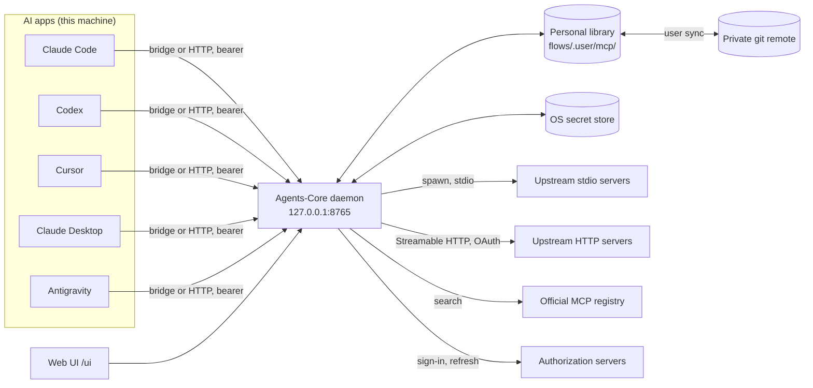
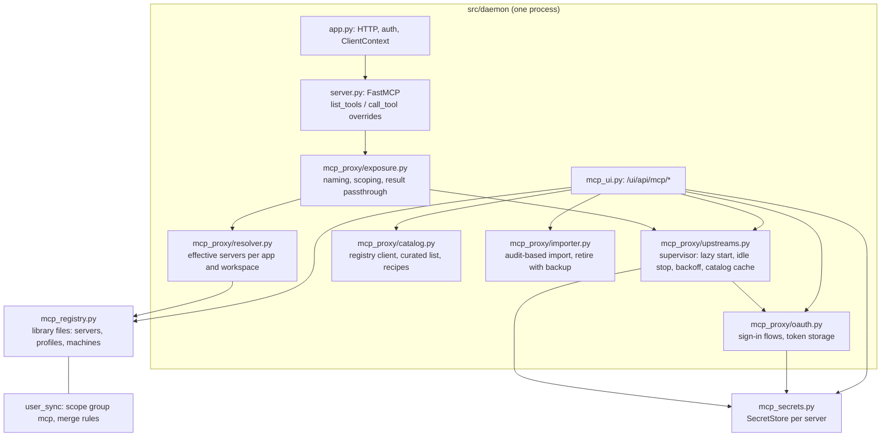
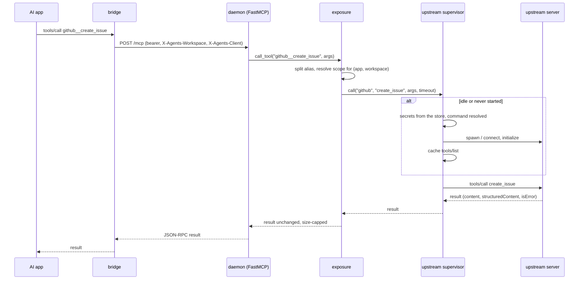
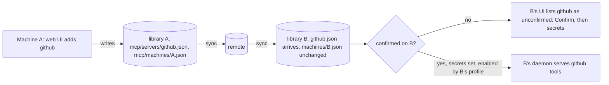

# MCP proxy: connect a server once, sync it through the library, scope it per machine and serve it to every AI app

Date: 2026-10-12. Status: proposal. Nothing of it is implemented; the task breakdown is at the end.

## Summary

The shared daemon becomes an MCP client of the user's other MCP servers and exposes their tools through the one `Agents-Core` entry every AI app already has. A server is added once, in the web UI (from a catalog, by import from an AI app's configuration, or by hand), and from then on:

- its definition lives in the personal library (`flows/.user/mcp/`) and reaches the user's other machines through [user library sync](user-sync.md), like flows and persona choices;
- its secrets (tokens, API keys, OAuth tokens) never enter the library: they live in the OS secret store of each machine, through the store classes sync already has (`src/user_sync/github.py`);
- each machine chooses which servers it runs (profiles and per-server switches in a file only that machine writes), and each AI app can be given a narrower set;
- the daemon starts an upstream server lazily on the first call that needs it, stops it when idle, and keeps its tool list cached, so adding a server costs nothing until a model uses it ("soft" proxying);
- the AI apps need no configuration change: new tools appear in the `Agents-Core` server after an MCP reconnect, under names of the form `<alias>__<tool>`.

The design reuses what the daemon and sync already provide: the stateless HTTP transport and its per-request client context (`src/daemon/app.py`, `src/daemon/workspaces.py`), the client configuration inventory (`src/daemon/audit.py`), the migration journal and backups (`src/daemon/clients.py`), the library's scope groups and secret scanner (`src/user_sync/scope.py`), the secret stores, and the MCP SDK's client transports and OAuth client (`mcp==1.28.1`).

## Goals and non-goals

Goals:

1. Add an MCP server once, in the web UI: from the official MCP registry or a curated list, by importing an entry an AI app already has, or by typing a command or URL.
2. Authenticate once per machine: a token or API key typed into the web UI, or an OAuth 2.1 sign-in that the daemon runs and whose tokens it refreshes.
3. Carry the definitions, the tool selection and the scopes to other machines through git (user library sync), without carrying any secret.
4. Run different sets of servers on different machines (profiles per machine), and expose narrower sets to individual AI apps.
5. Serve the tools to every AI app through the existing `Agents-Core` entry, in every client the daemon serves today: Claude Code, Codex, Cursor, Claude Desktop and Antigravity, including stdio servers that hand their session to the bridge (#266).
6. Never let an upstream server's failure break Agents-Core's own tools, and never spawn a process the user did not enable on this machine.

Non-goals (first release):

- Replacing the AI apps' own MCP configurations wholesale: imported entries are retired only on an explicit action, with a backup.
- Prompts, resources, sampling and elicitation passthrough (phase 2, see the tasks).
- A standalone stdio server (`AGENTS_STDIO_STANDALONE=1`, or a machine without the service, see #194) running the proxy: phase 3 at the earliest.
- Syncing secrets between machines, in any form.
- Exposing a proxied server to the Claude.ai connectors or to cloud sessions.

## What exists today

Verified in source on 2026-10-12.

| Concern | What exists | Where |
|---|---|---|
| Transport the apps use | One stateless Streamable HTTP endpoint, `POST /mcp`, bearer token, `X-Agents-Workspace` and `X-Agents-Client` headers; each request carries a `ClientContext` (app, workspace root) in `request.state` | `src/daemon/app.py` (`Service.dispatch`), `src/daemon/workspaces.py` |
| How the apps reach it | A Node stdio bridge per session (`bridge/stdio.mjs`) or an HTTP entry; one bridge per app and workspace; the stdio server hands over to the bridge (#266) | `src/daemon/clients.py`, `src/startup.py` |
| The server's tools | 18 tools and one prompt on a `FastMCP` subclass that already overrides `call_tool` for argument checks | `src/server.py` (`_WorkerInputMCP`) |
| Tool listing and calls in the SDK | `FastMCP.list_tools()` and `call_tool()` are plain overridable methods; the lowlevel server sets `request_ctx` for every request, so a `tools/list` handler can read the Starlette request and its `client_context` | `.venv/.../mcp/server/fastmcp/server.py`, `mcp/server/lowlevel/server.py` |
| Client transports in the SDK | `stdio_client`, `streamable_http_client`, `sse_client`, `ClientSession`; `ClientSessionGroup` aggregates several servers with a name hook but has no reconnection or lazy start | `mcp/client/*` |
| OAuth client in the SDK | `OAuthClientProvider(httpx.Auth)` with RFC 9728 and RFC 8414 discovery, dynamic registration (RFC 7591), client ID metadata documents, PKCE, the `resource` parameter, refresh; a `TokenStorage` protocol (tokens and client information), a `redirect_handler` that receives the authorization URL and a `callback_handler` that returns `(code, state)` | `mcp/client/auth/oauth2.py`, `mcp/shared/auth.py` |
| Inventory of the apps' MCP entries | Reads Claude Code (user, local per project, project `.mcp.json`), Codex (user, named profiles, project), Cursor, Claude Desktop (including the Windows MSIX copy), Antigravity and plugin manifests; today it reports names, transport, header names and the command's base name only | `src/daemon/audit.py` |
| Writing client files | Prepared changes, whole-file backups, a journal, `expected_versions` checks, restore; tokens never reach tracked files | `src/daemon/clients.py`, `src/daemon/registrations.py` |
| The personal library and sync | `flows/.user` with the groups `common`, `personas`, `history`, `components`, `repos/<key>`; an unknown top-level directory never syncs; a secret scanner blocks credentials before publication; `components.json` and `scopes.json` merge as sets, other JSON files take the remote version with a conflict record | `src/user_sync/scope.py`, `src/user_sync/merge.py`, `docs/user-sync.md` |
| Secret stores | `SecretStore` protocol (`load`, `save`, `delete`): macOS Keychain through `/usr/bin/security`, `secret-tool` on Linux, Windows Credential Manager, a private file as fallback; `default_store(directory, name)` | `src/user_sync/github.py` |
| Machine identity | Sync's `label` (platform plus a random suffix, never the hostname) in the private `user-sync.json`; #207 plans `machines/<id>.json` in the library with "this machine" recorded privately | `src/user_sync/engine.py`, #207 |
| Executables the service may start | The service runs with the system PATH only; `install` records absolute paths of the tools it needs (git, ssh-keygen, ssh-keyscan, lsof, Node) | `src/executables.py`, `src/daemon/service.py` |
| Web UI | One page with section tabs (Flows, Agents, Rules, Skills, Implants, History), the Sync page and the landing page; sub-modules per feature (`sync_ui.py`, `history_ui.py`) behind the loopback Host, the session cookie, the `X-Agents-UI` header and a same-origin Origin; the page's CSP allows `connect-src 'self'` only | `src/daemon/flows_ui.py`, `src/daemon/flows_ui.html` |
| Result sizes | Claude Code inlines at most 50,000 characters of a tool result (#196, #212) | `src/result_size.py` |
| Related open issues | #298 Integrations tab (every file Agents-Core changed in the apps), #297 Memory tab, #205 Settings page, #207 machine registry for scheduled flows, #292 one workspace contract, #213 tool result sizes, #233 instruction signing | GitHub |

External facts used below, verified on 2026-10-12:

- MCP specification 2025-11-25, Tools: tool names should be 1 to 128 characters of letters, digits, `_`, `-` and `.`; `listChanged` is a capability and `notifications/tools/list_changed` a server-to-client notification; results carry `content` and optional `structuredContent`, `isError` marks execution errors.
- MCP specification 2025-11-25, Authorization: HTTP transports use OAuth 2.1; stdio servers take credentials from the environment; clients discover the authorization server through Protected Resource Metadata (RFC 9728) and Authorization Server Metadata (RFC 8414); client registration is pre-registration, client ID metadata documents or dynamic registration (RFC 7591); PKCE `S256` and the `resource` parameter (RFC 8707) are mandatory; token passthrough is forbidden: a server that calls upstream APIs must not forward the token it received.
- Claude API: a tool `name` must match `^[a-zA-Z0-9_-]{1,128}$` ([Define tools](https://platform.claude.com/docs/en/agents-and-tools/tool-use/define-tools), read 2026-10-12). Claude Code's tool search passes tool names in `tool_reference` blocks, whose limit is reported as 64 characters in user reports, not on an official page; the design keeps a 64-character budget as a safe margin.
- Claude Code: tools of a server `S` are named `mcp__S__<tool>`; tool search is on by default, so only tool names and server instructions load at session start and definitions on demand; descriptions and server instructions are truncated at 2,048 characters; `_meta["anthropic/alwaysLoad"]` and `_meta["anthropic/requiresUserInteraction"]` are honoured per tool; `.mcp.json` expands `${VAR}`; OAuth for a remote server is run by Claude Code itself (`/mcp`, `claude mcp login`); `claude mcp add-from-claude-desktop` imports Desktop's stdio entries ([Claude Code MCP docs](https://code.claude.com/docs/en/mcp)).
- Official MCP registry: `GET https://registry.modelcontextprotocol.io/v0.1/servers?search=&cursor=&limit=&version=latest&updated_since=` and `GET /v0.1/servers/{name}/versions/{version}`; entries follow the `server.json` schema 2025-12-11: `name`, `title`, `description`, `version`, `packages[]` (`registryType`, `identifier`, `transport`, `environmentVariables[]` with `isSecret`, `isRequired`, `default`, `choices`, `packageArguments[]`, `runtimeArguments[]`, `runtimeHint`), `remotes[]` (`type` `streamable-http` or `sse`, `url`, `headers[]`, `variables`) and `_meta["io.modelcontextprotocol.registry/official"]` (`status`, `isLatest`, `publishedAt`).
- Codex and Cursor configuration keys below come from third-party documentation found on 2026-10-12 and are marked as such; the official pages must be read before the import code is written.

## Requirements

Functional:

- F1 Add a server from the catalog (official registry search, curated list), by import from an AI app, or by hand (stdio command or HTTP URL).
- F2 Store secrets per machine in the OS secret store; prompt for them in the web UI; show "set" or "not set", never the value.
- F3 Run an OAuth 2.1 sign-in from the web UI for a remote server; keep and refresh its tokens.
- F4 Sync definitions, tool selections, profiles and machine files through the library; keep secrets and machine-local state out.
- F5 Resolve, per request, which servers and tools the calling app sees on this machine.
- F6 Expose the resolved tools through the `Agents-Core` entry; forward calls; return results unchanged in content and structure.
- F7 Start upstream servers lazily, stop them when idle, keep a cached tool list, report their state.
- F8 Import an AI app's entries, extract their secrets into the store, and retire the original entries on request with a backup.
- F9 Manage everything from the web UI and, for scripting, from the CLI.

Non-functional:

- N1 `tools/list` answers from cache in under 50 ms for 1,000 tools; nothing is spawned by a list.
- N2 A call to an idle stdio server adds its start time once (typically 1 to 3 s for a cached `npx` package; measured values belong to the implementation), and under 5 ms of proxy overhead afterwards.
- N3 Memory: no upstream process runs unless a call needed it within the idle window (default 10 minutes); the daemon's own footprint does not change while every upstream is idle.
- N4 A failing or unauthenticated upstream never fails Agents-Core's own tools, the daemon's readiness or an update.
- N5 No secret appears in the library, in a tracked file the proxy writes, in a UI response, in a log line the proxy writes, or in text the proxy itself produces (remedies, errors, server instructions). Upstream results pass through unchanged and are not scanned: a server that echoes its own credential does so today too, when an app connects to it directly.

Constraints:

- C1 The daemon is stateless towards the apps: no server-to-client notification reaches a session, so a changed tool list needs an MCP reconnect in open sessions (as registrations do today).
- C2 The service runs with the system PATH: upstream commands must be absolute or resolved through the recorded tools.
- C3 Tool names reach the Claude API as `mcp__Agents-Core__<name>` in characters of `[A-Za-z0-9_-]`; the API allows 128, and the design budgets 64 for the reported `tool_reference` limit of Claude Code's tool search (see Naming).
- C4 Library files are plain JSON that two machines may edit; the sync merge is whole-file for JSON (remote wins, conflict record), set-based only for the files it knows.
- C5 The web page cannot reach the network (CSP): every external fetch (registry search, OAuth) goes through the daemon.
- C6 Windows and macOS have the service; Linux has none yet (#194).

Anti-requirements:

- Not a general-purpose MCP gateway for other users or hosts: loopback only, one OS user, the daemon's bearer token.
- No token passthrough of any kind: the apps' bearer token never leaves the daemon, and the upstream tokens are the daemon's own.
- No automatic start of a definition that arrived from another machine before this machine confirmed it.

## Estimation

Order-of-magnitude figures for one user; the implementation measures the real ones.

| Quantity | Estimate | Basis |
|---|---|---|
| Upstream servers per user | 5 to 20 | this user's clients list about ten MCP servers today (Atlassian, ClickUp, Cloudflare, Claude Docs, CodeGraph, TokenSave and others) |
| Tools per server | 5 to 70 | ClickUp's server exposes about 70 tools, Atlassian's about 25, GitHub's about 50 |
| Tools behind the proxy | 100 to 1,000 | product of the two |
| `tools/list` payload | 0.1 to 1.2 MB | about 0.6 to 1.5 KB of JSON per tool definition |
| Context cost when an app loads every definition upfront | 150 to 400 tokens per tool, so 1,000 tools would cost 150k to 400k tokens | typical JSON schema size; this is why scopes and the compact mode exist. Claude Code defers definitions (tool search); whether Codex, Cursor, Desktop and Antigravity load them upfront is recalled, not verified |
| Cold start of a stdio server | 1 to 5 s (`npx` with a warm cache), 0.2 to 1 s for an HTTP session | recalled, to be measured |
| Memory of a running Node stdio server | 60 to 150 MB each | recalled, to be measured; the shared daemon exists because 15 Python processes cost 22.9 GB (`shared-mcp-daemon-validation.md`), so ten always-on upstreams would undo part of that gain: hence lazy start and idle stop |
| Registry size in the library | at most a few hundred KB | 50 files of 1 to 4 KB |
| Calls per minute | under 60 | one model turn makes a handful of calls |

Consequences: caching the tool list is mandatory (N1); laziness is mandatory (N3); per-app scopes are a first-release feature, not a refinement.

## Architecture

### Context



### Containers and components



Module placement follows the existing split: library-side modules without daemon imports (`src/mcp_registry.py`, `src/mcp_secrets.py`, beside `src/user_flows.py` and `src/component_toggles.py`) so stdio servers and the CLI can read them; the runtime under `src/daemon/mcp_proxy/`; the UI routes in `src/daemon/mcp_ui.py` dispatched by `FlowsUI` like `sync_ui.py` and `history_ui.py`.

### Data flow: a tool call



A `tools/list` never reaches an upstream: the exposure layer reads the cached catalogs of the resolved servers. A server whose catalog was never fetched is listed by the tools its definition names (`tools.expose`, when a list) or not at all until the UI's "Connect now" fetches it. The UI fetches the catalog when a server is added, so this case is the exception.

### Data flow: OAuth sign-in

```mermaid
sequenceDiagram
    participant W as Web UI
    participant D as daemon
    participant M as MCP server
    participant AS as authorization server
    participant Br as browser
    W->>D: POST /ui/api/mcp/servers/notion/login
    D->>M: unauthenticated request
    M-->>D: 401, WWW-Authenticate resource_metadata
    D->>M: protected resource metadata (RFC 9728)
    D->>AS: authorization server metadata (RFC 8414)
    D->>AS: registration (pre-registered id, metadata document or RFC 7591)
    D-->>W: {authorization_url, flow_id}
    W->>Br: open authorization_url (PKCE, resource, state)
    Br->>AS: user consents
    AS-->>Br: redirect http://127.0.0.1:8765/ui/oauth/callback?code&state
    Br->>D: GET /ui/oauth/callback (session cookie, path /ui)
    D->>AS: token request (code_verifier, resource)
    AS-->>D: access and refresh tokens
    D->>D: tokens into the secret store; state ready
    D-->>Br: "Signed in, you can close this tab"
```

The daemon is the OAuth client; its redirect URI is loopback, which the specification allows. Tokens are refreshed by the SDK's provider on the next call; a refresh that fails puts the server into `needs_auth`, and the UI offers to sign in again.

### Data flow: sync and scopes



## Registry: files and schema

All registry files live in the personal library under `mcp/`, written atomically under the library lock as `src/user_flows.py` writes flows, with `src/user_library.notify` so the sync loop hears every change. Format version 1. Unknown keys are preserved on rewrite, so an older version never strips what a newer one wrote.

### `mcp/servers/<alias>.json`

One file per server. The alias is the file name and the tool prefix: `^[a-z0-9][a-z0-9_-]{0,11}$`, never containing `__` (12 characters at most, see Naming).

```json
{
  "format": 1,
  "alias": "github",
  "title": "GitHub",
  "description": "Issues, pull requests and code search on GitHub",
  "source": {"kind": "catalog", "name": "io.github.github/github-mcp-server", "version": "0.14.0"},
  "transport": {"type": "stdio", "command": "npx", "args": ["-y", "@modelcontextprotocol/server-github"], "env": {"GITHUB_API_URL": "https://api.github.com"}},
  "auth": {"kind": "none"},
  "secrets": [{"name": "GITHUB_PERSONAL_ACCESS_TOKEN", "target": "env", "required": true, "description": "A token with the repo scope"}],
  "tools": {"expose": "all", "deny": ["delete_repository"], "always_load": []},
  "limits": {"call_timeout_seconds": 120, "idle_seconds": 600},
  "instructions": "Use for GitHub issues and pull requests of the current repository.",
  "updated": "2026-10-12T10:00:00Z",
  "revision": "sha256 of the canonical JSON without this key"
}
```

- `source.kind` is `catalog`, `import` (`client`, `path`, `server`: where it came from, so a second import is recognised) or `manual`.
- `transport.type` is `stdio` (`command`, `args`, `env`, optional `cwd`), `http` (`url`, `headers`) or `sse` (same keys; deprecated upstream, accepted for import).
- `auth.kind` is `none`, `bearer` (`secret`: the name of the secret that holds the token), `header` (`name`, `secret`) or `oauth` (`scopes`, optional `client_id`, `client_metadata_url`, `authorization_server`, `callback_port`); OAuth tokens and client information live in the secret store under the server's entry.
- `secrets[]` names what the machine must supply: `target` is `env` (a variable of a stdio server), `header` (a request header of an HTTP server) or `url` (a `{variable}` of a URL template from the registry).
- `env` and `headers` hold non-secret values only. A save refuses a value that the secret scanner (`src/user_sync/scope.py`, `SECRET_PATTERNS`) matches, with the message to put it into the secret store; the same check runs on import. The scanner stays the last line of defence at publication.
- `tools.expose` is `all` or a list; `deny` always wins; `always_load` names tools that get `_meta["anthropic/alwaysLoad"] = true` in the listing.
- `revision` lets a machine detect that a definition changed since it confirmed it (see Scopes).

### `mcp/profiles/<name>.json`

A named set of servers with optional per-server tool narrowing: `{"format": 1, "servers": ["github", "clickup"], "tools": {"github": {"expose": ["list_issues", "create_issue"]}}}`. Profiles are shared; a machine refers to them by name.

### `mcp/machines/<machine-id>.json`

Written by one machine only, so it never conflicts in sync:

```json
{
  "format": 1,
  "id": "m-5b1c0d9e2f4a",
  "label": "mac-9a1c",
  "platform": "darwin",
  "profiles": ["work"],
  "servers": {"github": true, "playwright": false},
  "clients": {"codex": {"servers": {"clickup": false}, "mode": "compact"}, "claude-desktop": {"servers": "none"}}
}
```

- `id` is a random identifier created once per machine in the private state directory (`<state>/mcp/machine.json`); `label` is sync's label when sync is set up. #207 plans the same `machines/<id>.json` registry for scheduled flows: whichever lands first creates the helper, and the other reuses it. Until then the MCP registry keeps its own `mcp/machines/` directory so the two features do not block each other; a later migration can merge the directories.
- `servers` overrides the profiles per server; `clients` narrows per app, by the `X-Agents-Client` names (`claude-code`, `codex`, `cursor`, `claude-desktop`, `antigravity`, `stdio`); `mode` is `flat` (default) or `compact` (see Exposure).

### Private state (`<state>/mcp/`, never synced)

`machine.json` (this machine's id), `confirmations.json` (alias to the confirmed `revision`), `catalog/<alias>.json` (the last `tools/list`, `serverInfo`, `instructions`, the time), `logs/<alias>.log` (stderr and the supervisor's events, rotated at 1 MiB with three backups like `user-sync.log`), `registry-cache/` (official registry answers, 24 hours), `oauth/<alias>-flow.json` (an in-flight sign-in: state and PKCE verifier, deleted when it ends). Secrets go to the OS store under `agents-core-mcp-<installation id>-<alias>`, one JSON document per server (`{"env": {...}, "headers": {...}, "url": {...}, "oauth": {"tokens": ..., "client": ...}}`), through the OS backends of `default_store` (macOS Keychain, Windows Credential Manager, `secret-tool` on Linux). There is no file fallback: on a machine without a usable OS store every server with secrets stays in `needs_secrets` with the reason `no_secret_store`, and the UI names the store to install. Sync's `FileStore` is not reused for server credentials, which are more numerous and longer-lived than one GitHub token.

## Scopes and resolution

The effective set for a request is computed by a pure function of (registry revision, machine file, app, workspace) and cached until any input changes:

1. a server is a candidate when its definition is valid and it is named by one of the machine's profiles or switched on in `servers`;
2. `servers[alias] == false` removes it; `clients[app].servers[alias] == false` or `clients[app].servers == "none"` removes it for that app;
3. a workspace override (`repos/<key>/mcp.json`, phase 2) applies last;
4. a candidate is served only when this machine confirmed its current `revision` and every required secret is present; otherwise it is listed in the UI with its reason (`unconfirmed`, `needs_secrets`, `needs_auth`) and omitted from `tools/list`;
5. the tool set is `tools.expose` narrowed by the profile's `tools` and minus `deny`.

Confirmation: a definition this machine wrote, through its UI or CLI, is confirmed at once (a ledger in `confirmations.json`, as #207 proposes). A definition that arrived by sync, or whose `revision` changed elsewhere, waits for "Confirm" in this machine's UI. The machine-local security setting "run definitions changed elsewhere without confirmation" (default off; #205 hosts it) switches this off. The reason is in the pre-mortem: the library is also a channel for anyone who can push to the private remote.

## Runtime: upstream supervisor

`src/daemon/mcp_proxy/upstreams.py` owns one `Upstream` per server enabled on this machine, inside the daemon's lifespan (an `anyio` task group beside `UserSync`):

- **States**: `disabled`, `unconfirmed`, `needs_secrets`, `needs_auth`, `stopped`, `starting`, `ready`, `failed` (with `error`, `retry_at`, exponential backoff 5 s to 10 min, reset by "Connect now").
- **Start**: on the first call that needs the server, or from the UI. For stdio: secrets loaded from the store (the store may take up to `STORE_TIMEOUT`, 30 s, when the keychain is locked), the command resolved (an absolute path as given, else `npx` beside the recorded Node, `uvx`, `docker` or `python3` as recorded by `install` through `src/executables.py`; anything else fails with `command not found` and the remedy to give an absolute path), the process started with a minimal environment (the service's PATH, `HOME`, locale, the definition's `env`, the secrets) and stderr to the log, in its own process group (POSIX) or job object (`src/windows_job.py`), killed with the daemon. For HTTP: an `httpx` client with the headers and, for `auth: oauth`, the SDK's `OAuthClientProvider` with a `TokenStorage` bound to the secret store; `initialize`, then `tools/list` into the catalog cache. The SDK's `ClientSession` is used directly; `ClientSessionGroup` is not, because supervision and laziness are the core of this layer and the group offers neither.
- **Idle stop**: no call for `limits.idle_seconds` (default 600) stops a stdio process; an HTTP session is closed the same way. The cached catalog stays.
- **Callbacks from upstream**: `roots/list` answers the session's workspace root (the `ClientContext` of the call that started the server, refreshed per call); `sampling/createMessage` is refused (the daemon never samples, as for `describe_repo`); `elicitation/create` is refused in the first release and logged, URL-mode requests are surfaced in the UI (phase 2); progress and logging notifications go to the server's log.
- **Drain and updates**: a running call counts in `inflight` as today; on drain the supervisor stops accepting starts and ends upstream processes after the inflight calls finish; `update` and `auto-update` therefore wait for calls, not for idle upstreams.
- **Health**: `/health` and the overview gain `mcp: {servers: n, ready: n, failed: n}`; the usage statistics count calls per alias and app, and refusals per reason, so a silently failing server is visible without the log.

## Exposure

### Naming

An exposed tool is `<alias>__<tool>`. The budget is 64 characters: the Claude API allows 128, but the `tool_reference` names of Claude Code's tool search are reported to keep 64 (not verified on an official page), and nothing in the design needs more. `mcp__Agents-Core__` takes 18 of 64 characters, so `<alias>__<tool>` has 46. With an alias of at most 12 characters, the upstream name may keep 32. A longer upstream name, or one with characters outside `[A-Za-z0-9_-]` (the MCP specification also allows `.`), is shortened deterministically: unsupported characters become `_`, the name is cut to 27 characters and a 4-character hash of the original is appended after `_`; the catalog cache keeps the mapping and the UI shows both names. Agents-Core's own tools contain no `__`, so no exposed name collides with them.

### `tools/list`

The override in `src/server.py` appends, after the own tools, the resolved servers' cached tools with: the exposed `name`; `title` as upstream; `description` prefixed with `[<title>]` and cut to 2,048 characters (Claude Code's limit); `inputSchema` and `outputSchema` unchanged; `annotations` unchanged; `_meta` as upstream plus `anthropic/alwaysLoad` for `tools.always_load`; `icons` dropped. The server `instructions` of Agents-Core gain one line per resolved server with its `instructions` text, so tool search in Claude Code knows when to look for them; the line is cut so the total stays under 2,048 characters.

### `tools/call`

A name with `__` is split at its first `__`; an unknown alias or tool is a protocol error (`-32602`), as for an unknown own tool. The call runs with the server's timeout; the result is returned with its `content` blocks (text, image, audio, resource links, embedded resources) and `structuredContent` unchanged; `isError` passes through. The proxy neither inspects nor redacts result content (N5): what an upstream returns is the upstream's responsibility, as when an app connects to it directly; the proxy redacts only its own logs and messages. A result whose shown size (`src/result_size.py`) exceeds Claude Code's inline limit is handled as `read_history` does since #212 (a file in the session's `tool-results` directory with a pointer), because FastMCP would otherwise wrap the content again. An upstream failure (not started, crashed, timed out, `needs_auth`, `needs_secrets`) is an execution error with `isError: true` and a remedy sentence naming the MCP tab and the state, never a daemon exception: the model can tell the user what to do, and Agents-Core's own tools are unaffected.

### Compact mode (phase 2)

For an app configured with `mode: compact`, `tools/list` shows two tools instead of the servers' tools: `mcp_tools(server?, query?)`, which returns the exposed tools' names and descriptions (and the full schema of one tool when asked), and `mcp_call(server, tool, arguments)`. It keeps an app without deferred tool loading inside its context budget at the price of one extra call per discovery. Claude Code keeps the flat mode because its tool search already defers definitions.

### Changes in open sessions

Stateless HTTP carries no `notifications/tools/list_changed` to a session. After a change (a server added, a scope switched, a tool denied), the UI says to reconnect MCP in open sessions (`/mcp` in Claude Code, a restart elsewhere), the message the registrations report already uses. New sessions see the new list.

## Authentication

- `bearer` and `header`: the value is a secret of the server (`secrets[]`); the UI's secrets form writes it to the store; the request carries `Authorization: Bearer <value>` or the named header.
- `oauth`: the daemon runs the flow described above with the SDK's provider. Client registration is tried in the specification's order: pre-registered (`client_id` and an optional secret typed in the UI), a client ID metadata document when the authorization server advertises `client_id_metadata_document_supported` and Agents-Core hosts such a document (open question below), dynamic registration (RFC 7591) otherwise. The redirect URI is `http://127.0.0.1:<port>/ui/oauth/callback`; `callback_port` in the definition allows a fixed port for servers whose authorization server allows one registered URI only, in which case the daemon listens on that port for the duration of the flow. `state` is bound to the in-flight flow file; a callback with an unknown or expired state is refused. The scopes follow the specification's strategy: the `scope` of the 401 challenge, else `scopes_supported`, else the definition's `scopes`.
- An upstream that answers 401 after a refresh goes to `needs_auth`; the UI shows "Sign in" with the server's name; nothing retries in a loop.
- The daemon never forwards anything from the apps' request to an upstream: not the bearer token, not a header, not the workspace identity. Upstream requests carry only what the definition and the store provide.

## Catalog

Two sources behind one search box:

1. **The official MCP registry**, fetched by the daemon (`/v0.1/servers?search=<text>&version=latest`, then the version detail), cached 24 hours in `registry-cache/`. A `server.json` becomes a definition draft: a `packages[]` entry with `registryType` `npm` becomes `npx -y <identifier>@<version>` with `runtimeArguments` and `packageArguments` (named and positional, with their `Input` prompts); `pypi` becomes `uvx <identifier>==<version>`; `oci` becomes `docker run -i --rm <identifier>`; `nuget` and `mcpb` are shown as unsupported in this release. `environmentVariables[]` and `headers[]` with `isSecret` become `secrets[]`; others with a `default` or `choices` become form fields. A `remotes[]` entry becomes an HTTP definition whose `auth` is detected on first contact (a 401 with `WWW-Authenticate` means `oauth`; a `headers[]` secret means `header`; otherwise `none`).
2. **A curated list** in the repository (`mcp/catalog.json` at the installation root; tracked, English, with tested recipes for servers the installer already knows: GitHub, GitLab, Atlassian, ClickUp, filesystem, fetch, Playwright, Context7, and the daemon's own document OCR server), each with its secrets, recommended `instructions` and tool denies. The curated list is the fallback when the registry is unreachable.

`install` records `npx` (beside the recorded Node), `uvx` and `docker` the way it records git (`src/executables.py`, `protected` first); a missing runtime is reported on the server's card with the command to install it, not at add time.

## Import from the AI apps

`src/daemon/audit.py` grows a second reader that returns, for import only and never over the audit CLI, the entries' full transport fields:

- Claude Code: `type`, `command`, `args`, `env`, `url`, `headers`, `oauth` (`clientId`, `callbackPort`, `scopes`), from the user scope and from each project scope (`projects.<root>.mcpServers`) and `.mcp.json`, with `${VAR}` and `${VAR:-default}` resolved from the daemon's environment or left as a required secret when unset;
- Codex: `command`, `args`, `env`, `url`, `http_headers`, `env_http_headers`, `bearer_token_env_var` (third-party documentation; verify against the official page);
- Cursor: `command`, `args`, `env`, `url`, `headers`, `auth` (`CLIENT_ID`, `CLIENT_SECRET`, scopes; third-party documentation; verify), with `${env:NAME}` resolved the same way;
- Claude Desktop: `command`, `args`, `env`;
- Antigravity: `command`, `args`, `env`, `url`, `headers`.

Never imported: `Agents-Core` and `Agents-Core-Desktop` entries; an app's own OAuth tokens (Claude Code and Codex keep them in their own stores; the user signs in again through the daemon); Claude.ai connectors (not in any file).

An import creates the definition with `source.kind: import`, detects secrets by header name (`Authorization`, `*-Key`, `*-Token`), by variable name (`*TOKEN*`, `*SECRET*`, `*KEY*`, `*PASSWORD*`) and by the scanner, puts their values into the store, and leaves the rest in `env` or `headers`. The alias is the entry's name lowered and cut to 12 characters, with a suffix on collision. The UI shows the entries grouped by app and file, with the ones already imported marked (by `source`), and offers "Retire the original entry" per app: a `ClientMigration` change that removes the entry from that file, journaled and restorable with `restore-clients`, refused for a tracked file as today. Retiring is never automatic: a user may keep an app's direct connection and the proxied one side by side. Until the original entry is retired its credential stays in the app's file; when that file is Git-tracked, retirement is refused as today, so the import report and the server's card flag the entry as `source_holds_secret` with the file path, and the owner removes the value by hand.

## Web UI and CLI

An **MCP** section tab beside Integrations (#298), in the page's list-and-item layout:

- the list: one row per definition with its state chip (`ready`, `idle`, `starting`, `failed`, `needs sign-in`, `needs secrets`, `unconfirmed`, `disabled`, `invalid`), its title, alias, transport, the number of exposed tools and the apps that see it on this machine; a search field; the buttons **Add from catalog**, **Import from apps**, **Add manually**;
- the item: tabs **Overview** (the definition, the source, the machine's switch, the profile membership, "Connect now", "Stop", "Confirm" when unconfirmed), **Tools** (the cached tools with switches that edit `expose` and `deny`, each tool's exposed name and description), **Secrets** (one field per `secrets[]` entry, "set" or "not set", write-only; "Sign in" and "Sign out" for OAuth), **Scopes** (this machine's profiles and the per-app switches and mode), **Log** (the tail of the server's log, secrets redacted);
- **Machines**: the machine files the library holds, this one editable, the others read-only with their labels;
- the sync chip and conflicts: a server file in conflict is listed with "Keep mine" and "Use theirs", as flows are.

Routes under `/ui/api/mcp/` with the History tab's protections (the page header on GET too: catalog searches and sign-ins reach the network), bodies of at most 64 KiB, `Cache-Control: no-store`, and never a secret in an answer. The OAuth callback `GET /ui/oauth/callback` is a page route (the session cookie's path is `/ui`) that renders a short HTML page.

CLI, for scripting and for parity with #205: `python -m src.daemon mcp list|show|add|import|remove|enable|disable|secret set|login|logout|confirm|connect|logs`, each calling the service and printing its JSON; `add` takes `--catalog NAME`, `--command ...` or `--url ...`; `secret set` reads the value from stdin.

## Sync integration

- `src/user_sync/scope.py`: a new group `mcp` for `mcp/**`; `groups()` returns `("mcp",)` for `mcp/servers/*.json`, `mcp/profiles/*.json` and `mcp/machines/*.json`, and None for anything else under `mcp/`, so stray files never sync. The group can be excluded in `.agents-sync/scopes.json` like the others, which keeps the whole registry on one machine.
- `src/user_sync/merge.py`: machine files are single-writer, so the default rule (changed on one side only) holds; a server or profile file changed on both sides takes the remote version with a conflict record of kind `mcp`, as other JSON files do today. `.history` versions of the files are not kept (the sync's Git history already holds them).
- The secret scanner runs on every `mcp/**` file as on every other; a server file that holds a secret is blocked from publication and shown in the UI like a blocked flow.
- `components.json`-style set merging is not needed: the per-machine files remove the only concurrent-edit case.
- The daemon's sync loop already schedules a cycle after a library write through `notify`; the registry writer calls it.

## Security

- **Trust boundary**: the proxy runs upstream programs chosen by the user, as the user, which is the trust level of any MCP server an app starts today. What is new is the channel: a definition can arrive from another machine through the remote. Confirmation per machine (default) closes it; the security setting that opens it is machine-local and logged (#205).
- **No token passthrough**: nothing from an app's request reaches an upstream. The daemon's bearer token stays in the bridge configurations; upstream credentials are the daemon's own (the MCP authorization specification's rule for servers that act as clients).
- **Secrets**: never in the library (writer check plus the scanner), never in a UI answer, never in a log (the supervisor redacts the store's values from stderr lines before writing them), never in a tracked file the proxy writes (retiring an entry writes nothing new; adding never writes to client files; a credential an import found in a Git-tracked app file stays there until the owner removes it, and the server's card says so), never in a file of the state directory (no file fallback: without an OS secret store a server with secrets does not start). The store items are per installation and server.
- **Commands**: resolved to absolute paths before start; the environment of an upstream is minimal; the working directory is the definition's `cwd` or the state directory, never a workspace unless the definition says so.
- **Web UI**: the existing protections; the callback route checks `state` and the session; the catalog search sends the user's query to the registry and nothing else.
- **Audit**: every registry write, confirmation, secret write, sign-in and retirement goes to `service.log` without values.
- **Signing**: `mcp/**` is instruction-adjacent content; the instruction signing epic (#233) can cover it later as it covers flows.

## Trade-off analysis

| Decision | Options | Recommendation and why |
|---|---|---|
| How the apps see upstream tools | (A) aggregate under the `Agents-Core` entry; (B) one daemon endpoint per upstream (`/mcp/<alias>`), written into each app as its own entry by `registrations.py`; (C) write the upstream entries themselves into the apps | (A). No client file changes, scopes decided server-side, works for every client the daemon serves and for stdio hand-over (#266); the cost is the `<alias>__` prefix and a reconnect after changes. (B) gives native names (`mcp__github__*`) and per-server tool search entries but multiplies the fragile client writes #292 and #298 describe; it stays a phase 3 option per server. (C) defeats "connect once" and puts secrets into client files |
| Where definitions live | (A) one file per server, profile and machine in the library; (B) one `mcp.json`; (C) the private state directory | (A). Per-file merging and single-writer machine files avoid conflicts; (B) would conflict on every concurrent edit; (C) cannot sync |
| Where secrets live | (A) OS secret store only, failing closed without one; (B) an encrypted blob in the library with a passphrase; (C) `.env` | (A). Reuses the tested store classes, keeps the library free of secrets and never writes a credential to disk; a machine without an OS store runs only servers without secrets. (B) would make the remote a secret carrier and needs key management; it is explicitly out of scope. (C) is per installation and plain text |
| Upstream client | (A) own supervisor over the SDK transports and `ClientSession`; (B) `ClientSessionGroup` | (A). The group lacks reconnection, lazy start, idle stop and per-server catalogs, and raises on name collisions |
| Start policy | (A) lazy start, idle stop; (B) always on; (C) a process per call | (A). Bounded memory, no cost for unused servers; the first call pays the start. (B) undoes the daemon's memory gain; (C) pays the start on every call |
| Tool naming | (A) `<alias>__<tool>`; (B) `<alias>.<tool>`; (C) meta-tools only | (A). (B) fails the Claude API pattern; (C) costs a discovery call on every use and hides tools from permission rules; it stays the compact mode for apps that need it |
| Scopes | (A) profiles plus per-machine files plus per-app overrides; (B) per-machine only | (A). Profiles let a new machine pick "work" once; the per-app override is what makes Codex and Desktop usable with many servers |
| OAuth registration | (A) pre-registered, then metadata document, then dynamic registration; (B) dynamic registration only | (A), the specification's order. Some authorization servers refuse dynamic registration; a metadata document needs a hosted document (open question) |

## Failure modes

| Failure | Effect | Handling |
|---|---|---|
| An upstream crashes or will not start | its tools stay listed from the cache; calls fail | `failed` with backoff; `isError` results with the remedy; nothing else affected |
| The secret store is locked or slow | a start waits up to 30 s | `needs_secrets` with the store's message; "Connect now" retries |
| An OAuth refresh fails | calls answer 401 | `needs_auth`; the UI offers "Sign in" |
| A definition is malformed (edited by hand, a newer format) | that server is `invalid` | others unaffected; the UI shows the parse error |
| Two machines edit one server file | remote wins, conflict record | the MCP tab lists it with both versions |
| A runtime (`npx`, `uvx`, `docker`) is missing | that server fails to start | the card names the runtime and the recorded path |
| Two upstream tools map to one shortened name | one would shadow the other | the second gets a different hash suffix; the mapping is per server, so collisions are only within a server |
| A result is larger than the app can take | Claude Code would truncate or reject | the size path of #212 |
| The daemon restarts during a call | the call fails in the app | drain waits for inflight calls; a restart ends the upstreams; sessions reconnect |
| The library is excluded from sync (`mcp` group) | nothing syncs | the UI says so on the Machines view |

## Pre-mortem

October 2027: the MCP proxy is switched off. What went wrong?

| # | How it failed | Likelihood | Impact | Mitigation | Early signal |
|---|---|---|---|---|---|
| 1 | A definition pushed to the remote (another machine, a leaked deploy key) started a program on every machine | medium | critical | confirmation per machine, default on; the setting that disables it is machine-local and logged | `unconfirmed` servers the user did not add |
| 2 | Codex and Desktop sessions became slow and expensive because 600 tool definitions loaded on every start | high | high | per-app scopes in the first release; the compact mode; the UI shows the number of tools each app sees | long session starts, context warnings |
| 3 | A secret reached the library through a `headers` value and was pushed | low | high | the writer refuses scanner matches; the scanner blocks publication; the UI shows blocked files | a `blocked` file in the sync status |
| 4 | The first call to a cold `npx` server timed out in the app | medium | medium | "Connect now" from the UI after adding; the app's tool timeout is long (Claude Code: hours by default); the supervisor keeps the process after the timeout so the second call succeeds | `starting` for more than 10 s in the log |
| 5 | Keychain prompts blocked the daemon's event loop | medium | high | store calls run in threads with the 30 s timeout, as sync's do; the daemon created the items so `security` reads them without a prompt | `needs_secrets` with a timeout message |
| 6 | An upstream server's tool names collided with each other after shortening, and the wrong tool ran | low | high | deterministic shortening with a hash; a test over a corpus of real tool names | a mapping with two entries for one name in the catalog cache |
| 7 | An update killed long upstream calls and corrupted a remote state | low | medium | drain waits for inflight calls as today; upstreams end after them | calls failing at update time |
| 8 | The proxy was built but the user kept the apps' own entries, so every server ran twice | medium | medium | the import view shows duplicates and offers to retire the originals; the Integrations tab (#298) lists both | two processes of one server in the baseline |

## Operational considerations

- **Monitoring**: per-server state, last error and last call in the UI and `/health`; call counts per alias and app in the statistics; refusals per reason.
- **Logs**: `<state>/mcp/logs/<alias>.log`, rotated; `service.log` for registry and secret events.
- **Deployment**: the feature ships with the daemon; a definition format change is additive (`format` bump with readers accepting older formats); no migration of client files.
- **Windows**: job objects for upstream processes; the Credential Manager store; the MSIX note of `state.py` already applies to the state directory.
- **Linux**: no service yet (#194); the registry and the UI code are platform-neutral so the proxy comes with the service.
- **Measurement**: the implementation records start times and memory of the first ten servers it runs (`scripts/daemon_baseline.py` can be extended) and the plan's estimates are replaced by them in the validation document.

## Open questions

1. **Client ID metadata document**: hosting `https://<domain>/agents-core/client.json` would let the daemon sign in to authorization servers that refuse dynamic registration without a per-user client id. Which domain, and is a loopback redirect URI acceptable to the servers that matter? Until decided, pre-registration and dynamic registration cover the cases.
2. **Machine registry ownership**: #207's `machines/<id>.json` or this plan's `mcp/machines/`; the first to land defines the helper (`src/machine_identity.py`), the other reuses it.
3. **Per-workspace scopes**: whether `repos/<key>/mcp.json` should follow the repository group's sync rules (portable only with an `origin`) or stay machine-local; proposed: the group's rules, so a team repository can carry its recommended servers.
4. **Compact mode defaults**: measure the context cost in Codex, Cursor, Desktop and Antigravity before choosing a default per app.
5. **Prompts as commands**: Claude Code lists MCP prompts as `/Agents-Core:<prompt>`; proxied prompts would appear as `/Agents-Core:<alias>__<prompt>`. Worth it, or only tools and resources in phase 2?

## Task breakdown

Filed on 2026-10-12 as the epic #306 and its parts #307 to #322, every one labelled `area:mcp-proxy`. Dependencies name the tasks.

| # | Title | Labels | Depends on |
|---|---|---|---|
| E, #306 | MCP proxy: connect an MCP server once in the web UI, sync it through the library, scope it per machine and client, and serve it to every AI app through Agents-Core (epic) | enhancement, epic, area:daemon, area:web-ui, area:user-sync, area:clients, area:security | — |
| T1, #307 | MCP proxy: test fixtures, a fake upstream MCP server and a fake OAuth authorization server | enhancement, area:tests | — |
| T2, #308 | MCP proxy: server registry in the personal library and secrets in the OS secret store | enhancement, area:user-sync, area:daemon, area:security | T1 |
| T3, #309 | MCP proxy: user sync carries the registry: the `mcp` scope group, single-writer machine files and server conflicts | enhancement, area:user-sync | T2 |
| T4, #310 | MCP proxy: upstream supervisor in the daemon: lazy stdio and HTTP sessions, idle stop, backoff, catalog cache and logs | enhancement, area:daemon | T1, T2 |
| T5, #311 | MCP proxy: expose upstream tools through the Agents-Core entry: naming, scoped tools/list, tools/call passthrough and errors with remedies | enhancement, area:daemon, area:clients | T4 |
| T6, #312 | MCP proxy: scopes per machine, profile and app, and confirmation of definitions that arrived from another machine | enhancement, area:user-sync, area:daemon, area:security | T2 |
| T7, #313 | MCP proxy: OAuth 2.1 sign-in run by the daemon, with bearer and header authentication for remote servers | enhancement, area:daemon, area:security, area:web-ui | T1, T4 |
| T8, #314 | MCP proxy: catalog from the official MCP registry and a curated list, with recorded runtimes (npx, uvx, docker) | enhancement, area:daemon, area:installer | T2 |
| T9, #315 | MCP proxy: import servers from the AI apps' configurations, move their secrets to the store and retire the originals on request | enhancement, area:clients, area:daemon | T2 |
| T10, #316 | Web UI: MCP tab to add, import, authorize, scope and inspect proxied servers | enhancement, area:web-ui | T2, T4, T5, T6, T7, T8, T9 |
| T11, #317 | MCP proxy: CLI `python -m src.daemon mcp …` and documentation | enhancement, documentation, area:daemon | T5, T7, T9 |
| T12, #318 | MCP proxy: compact mode with two meta-tools for apps that load every tool definition upfront | enhancement, area:clients, area:daemon | T5, T6 |
| T13, #319 | MCP proxy: prompts and resources passthrough, roots from the session workspace, elicitation surfaced in the web UI | enhancement, area:daemon, area:web-ui, area:clients | T5, T10 |
| T14, #320 | MCP proxy: per-workspace scopes in the repository group (`repos/<key>/mcp.json`) | enhancement, area:user-sync, area:daemon | T6 |
| T15, #321 | MCP proxy: expose a server as its own entry in an app through a per-upstream daemon endpoint | enhancement, area:daemon, area:clients | T5 |
| T16, #322 | MCP proxy: measure start times, memory and context cost, and record them in a validation document | documentation, area:evals, area:daemon | T5, T10 |

Order of work: T1; then T2; then T3, T4, T6, T8 and T9 in parallel; then T5 and T7; then T10 and T11; T12 to T16 after the first release. T2 through T11 are the first release.

## References

- [MCP specification 2025-11-25: Tools](https://modelcontextprotocol.io/specification/2025-11-25/server/tools)
- [MCP specification 2025-11-25: Authorization](https://modelcontextprotocol.io/specification/2025-11-25/basic/authorization)
- [Official MCP registry API](https://registry.modelcontextprotocol.io/openapi.yaml) and the [server.json schema 2025-12-11](https://static.modelcontextprotocol.io/schemas/2025-12-11/server.schema.json)
- [Claude Code: Connect to tools with MCP](https://code.claude.com/docs/en/mcp)
- [Claude API: Define tools](https://platform.claude.com/docs/en/agents-and-tools/tool-use/define-tools)
- Codex configuration keys (third-party, to verify): [Mintlify mirror of the Codex docs](https://www.mintlify.com/openai/codex/configuration/mcp-servers); Cursor keys (official page, partially read): [Cursor MCP docs](https://cursor.com/docs/mcp)
- This repository: [Daemon operations](shared-mcp-daemon.md), [User library sync](user-sync.md), [Routing](routing_flow.md), issues #292, #298, #297, #207, #205, #213, #233
