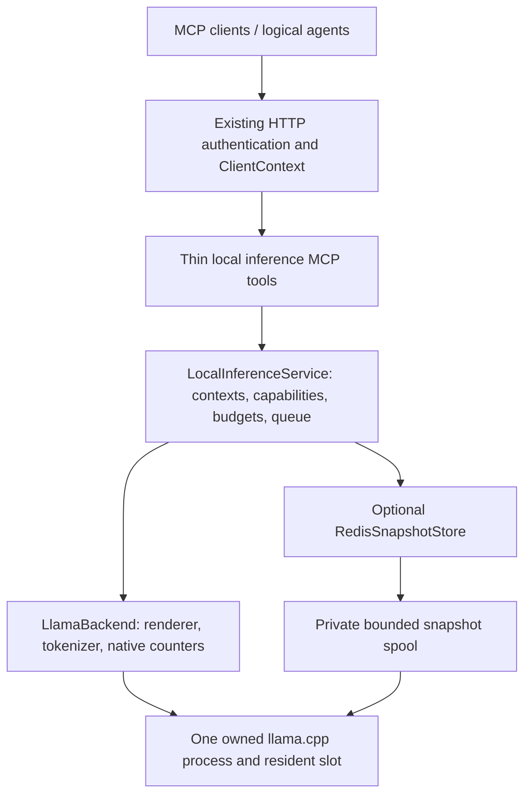

# Architecture and invariants

This is the implementation contract for `src/local_inference/`. The recorded base predates these modules; current checks and live capability limits are listed in the [implementation report](implementation-report.md).

## Component boundary

Keep inference isolated from retrieval and persona activation. Existing routing must stay responsive while a completion is running. A missing model, an unavailable Redis or an unsupported model profile must not make ordinary persona, flow or history tools fail.

The shared HTTP daemon is the broker. Do not add a second public HTTP service in version 1. The internal llama.cpp endpoint uses a unique pathname Unix socket in a fresh owner-only directory and a private generated API key. Every native HTTP connection uses that socket; there is no TCP fallback. The HTTP base URL is only an authority placeholder. All slot operations, including probing, saving, restoring and erasing, pass through one scheduler. Generation uses submit/result/cancel jobs: the existing bridge has a 120-second upstream deadline, so never keep one MCP request open for the whole model operation. A result poll waits at most 20 seconds. Native SSE is internal; this is not MCP token streaming.

## Module ownership

| New module | Responsibility |
|---|---|
| `src/local_inference/config.py` | Strict owner configuration; disabled default; limits; no import-time I/O |
| `src/local_inference/models.py` | Internal dataclasses/enums and strict JSON request/result schemas |
| `src/local_inference/profile.py` | Canonical JSON hashing, model/engine/renderer fingerprints, engine epoch |
| `src/local_inference/context.py` | Immutable captured context, scoped capabilities, TTL, request/output budgets |
| `src/local_inference/render.py` | Deterministic messages; server rendering/tokenization; exact token comparison |
| `src/local_inference/process.py` | Owned process lifecycle, private key/spool, health, termination/reaping |
| `src/local_inference/child_exec.py` | POSIX exec wrapper installing and acknowledging the native file-size limit |
| `src/local_inference/backend.py` | Narrow engine protocol and typed prepared prompt/completion counters |
| `src/local_inference/capabilities.py` | Private signed profile-bound owner diagnostic evidence |
| `src/local_inference/llama.py` | Bounded async HTTP; native protocol adapter; counters; slot snapshot operations |
| `src/local_inference/service.py` | FIFO admission, idempotency, serialization, cancellation, state transitions |
| `src/local_inference/redis_store.py` | Optional chunked opaque snapshots; manifests, integrity, TTL and capacity |
| `src/local_inference/snapshots.py` | Private bounded spool reservations, native save/restore, scoped deletion references |
| `src/local_inference/metrics.py` | Bounded aggregate counters and timings without prompt/token secrets |
| `src/local_inference/tools.py` | Tool implementations that receive explicit ClientContext and service |
| `src/schemas/local_inference.py` | Public Pydantic schemas if needed to match repository conventions |

Avoid duplicate schemas: if public schemas live under `src/schemas/`, import them into the package rather than defining two versions. Keep `src/server.py` wrappers small and annotate them through the existing `tool_hints` convention. Use dependency injection for the service, clock, process launcher, HTTP transport and snapshot store.

## Configuration and lifecycle

Use one new owner-controlled environment variable: `AGENTS_LOCAL_INFERENCE_CONFIG`, an absolute path to a JSON file. Unset means disabled. The file also has `enabled: false` by default. Configuration is not supplied by a model tool call. Canonicalize the complete validated configuration, with defaults expanded and sorted keys, as UTF-8 JSON without whitespace or nonfinite numbers; SHA256 is owner_config_revision. Include the schema version, configured paths/source bindings and Redis settings, but never resolved credentials. Version 1 deliberately invalidates contexts/snapshots after any configuration revision change; secret rotation alone does not change the revision. Reload requires service restart rather than mutating a live registry. Unknown fields, relative binary/model paths, nonfinite numbers, booleans where integers are expected, or invalid limits are errors. Do not silently clamp owner mistakes.

Read configuration lazily when the optional service is first accessed. The selected path must resolve to a regular UTF-8 JSON file of at most 1 MiB; owner-selected symlinks to regular files are allowed. Open nonblocking before inspecting the descriptor so a FIFO cannot stall the daemon. Invalid optional configuration yields a structured local-inference error, not daemon startup failure. No model launch, tokenization, Redis connection or GGUF hashing on module import or on disabled status requests.

When enabled, context creation captures text/files without starting the model. The first generate request may launch the owned child. Include startup in its full elapsed time. Hash the engine executable and GGUF in a worker thread before launch; record file identity, size and mtime and revalidate on reuse. A changed file requires rehash and a new profile. Never trust a caller's claim about the model hash.

Version 1 local inference supports POSIX macOS/Linux. Other platforms return unsupported for the optional backend while ordinary MCP remains usable. Build an argv list with explicit supported flags. Do not accept arbitrary extra shell commands, environment variables or engine URLs from clients. Owner configuration gives the model path, binary path, context size, GPU layer count and thread count. The schema-1 `port` field remains accepted for configuration compatibility but is unused; occupying that legacy TCP port neither redirects nor blocks the private engine. A socket bind or connection failure never causes attachment to a TCP listener. Use the process handle we launched to stop only our child. Bind a private API key using the pinned engine's key-file mechanism; never print the key or place it in model-facing output.

The socket directory is created beneath the resolved system `/tmp` after checking owner/root-controlled ancestors and sticky protection for writable parents. Its mode is 0700, its device/inode identity is retained, and the encoded socket path must fit the macOS 104-byte limit and contain no host-list delimiter. Before creating the HTTP client, reject a changed or nonprivate directory and a symlink or wrong-type socket entry. Cleanup follows confirmed child reaping and removes only the recorded directory identity. A new engine epoch gets a new socket path. Abrupt process death may leave a private socket-only temporary directory for operating-system cleanup; it contains no API key, prompt or KV snapshot and is never reused. Persistent authenticated spool reconciliation remains separate and unchanged.

This boundary trusts the owner UID, root and the owner-selected executable, as the existing private key file does. It does not isolate malicious processes already running as that UID. The wrapper acknowledgement proves the file-size limit, not listener readiness; only startup health checks retry a delayed Unix listener. The pinned engine's [Unix bind implementation](https://github.com/ggml-org/llama.cpp/blob/d81235049384534c167caea52b85a694f6103d14/tools/server/server-http.cpp#L454-L483) supplies pathname support without a new binary or TLS build requirement.

Keep the process alive across requests until broker shutdown or an error requiring restart. No idle unload policy in version 1. Wire local job counts into Service.health and Controller._drain; existing inflight/io_pending/streams do not cover detached generation. Administrative drain refuses new submissions while existing work finishes; resume reopens admission after a drain timeout. Shutdown refuses new jobs, resolves queued jobs with an explicit service-stopping result, terminates the owned child with a bounded grace period, kills only that owned process if necessary, reaps it, and closes HTTP/Redis clients. Do not wait indefinitely in an executor shutdown.

MCP direct stdio does not create a second broker: these new tools return `transport_unsupported` there. The existing stdio-to-HTTP bridge still works because the serving side is the shared daemon. Existing stdio tools retain their behavior.

## Identity and source freshness

The existing daemon authenticates a bearer token at the HTTP boundary. Its workspace header selects a registered project. Neither `actor` labels nor `X-Agents-Client` is a separately authenticated human/agent identity. Version 1 supports trusted local clients sharing one OS account; do not advertise isolation against a process that can read the daemon's credentials.

Use the request's existing ClientContext; require a valid HTTP workspace. Resolve paths with its workspace boundary. Do not accept a raw workspace root or workspace UUID in tool JSON to override transport identity. A mismatching workspace must fail even when the caller supplies a valid capability from another workspace.

Each context has a public random context ID and a separate 256-bit owner capability. Child grants receive separate random access capabilities. Store only capability digests; compare in constant time. Labels help diagnostics only. Never authorize by label alone. Every context/grant is bound to the registered workspace, immutable owner-configuration revision, TTL and budgets. Before the first dispatch the stable byte-level model profile may be unresolved; resolve it once after hashing/launch and bind it atomically to that context. A later incompatible profile requires a new context; never silently reinterpret an old context under new weights.

The memory subsystem may normalize a linked worktree to its main checkout. Do not change that global behavior. Owner configuration contains source_roots: a map from a short root ID to an absolute path and its expected registered workspace root. If source_paths is nonempty, context creation must specify source_root_id from that map. Resolve both paths canonically and require the configured workspace binding to equal ClientContext.root. Never infer a sibling worktree or permit an arbitrary tool-supplied path. Capture the actual selected source root in context identity and return it on successful creation. A different worktree produces a different identity even when files currently match.

The request supplies source paths relative to that selected owner-authorized root. The service reads them itself, captures content and SHA256, and includes the captured text in the shared context. Reject absolute paths, traversal, escaping symlinks, nonregular files and invalid UTF-8. Use a directory file descriptor for the canonical configured root and walk each relative component with dir_fd plus O_NOFOLLOW; intermediate components require O_DIRECTORY. Reject all symlink components in version 1, even internal ones. Open the final component O_RDONLY | O_NOFOLLOW | O_NONBLOCK so a FIFO cannot block before inspection; immediately require a regular file by fstat, read at most the limit plus one byte, and compare fstat identity/size/mtime before and after. Repeat this same safe-open/hash procedure for freshness checks. Do not use resolve-then-ordinary-open as the protection against a swap. Bound per-file and aggregate reads.

Before dispatch, after waiting for the slot, recheck the files against captured hashes. Changed or missing files make the context stale: return `source_changed`, invalidate its grants and avoid using its Redis snapshot. The caller creates a fresh context. Source edits during generation cannot be prevented by this service; recheck after generation and return `source_changed` with no publishable answer if detected. The downstream host must still recheck before applying generated code.

Do not pass raw prompts, grant tokens, source content or binary snapshots to log_interaction, persona debug logs, traces or metrics. Add redaction tests with sentinel secrets. Results are not automatically logged. Local model output is data, never automatically executed.

## Context and rendering

A context consists of common system instructions, shared data text, a captured source manifest and limits. It is immutable after creation. A generation adds a task-specific user message. A child role or prepared worker_context belongs in that task message unless the caller deliberately creates a different common context.

Build message roles deterministically: common system instructions as system; shared text/files as one explicitly delimited user-data message; the task as a final user message. Preserve original file bytes and task strings inside their defined framing. No timestamps, random IDs, capability tokens, actor names or changing counters in the shared prompt prefix. Never reinterpret source text as new tool authorization.

Use the pinned engine's renderer and tokenizer for the complete request. Do not assume that concatenating separately tokenized strings equals tokenizing their concatenation. Do not fabricate a reusable prefix by tokenizing a truncated chat template. Keep the full authoritative rendered input for cold fallback.

Validate `input_tokens + max_output_tokens <= context_tokens` before model dispatch. Reject overflow; do not silently truncate, summarize or drop instructions. Record the actual longest common token prefix with the previous resident input plus generated tokens. Native reuse must not exceed that prefix or the current input length.

The pinned llama.cpp build marks the exact native capacity boundary as truncated. Its validated profile therefore declares one token of `context_headroom`; admission uses `effective_context_tokens = configured context_tokens - context_headroom`. Status reports both limits once the profile is known. Backends that require no headroom retain equality acceptance. This explicit engine constraint preserves the no-truncation invariant; it is not silent prompt truncation.

The model receives full rendered text in version 1. Internal token IDs support validation and accounting; integer transport is not required for reuse. Do not expose a general raw-token-input API yet.

The pinned native SSE protocol leaves `id_slot=-1` on partial results and assigns `id_slot=0` only on the final result; validate each frame according to that distinction. The adapter still requires exact integer fields, one authoritative token ID per emitted partial, complete final counters and processed-prompt token agreement. During owned startup, the exec/write-limit acknowledgement can precede the private Unix listener. Retry only the read-only health check for refused connections, connect timeout or loading (503), under the total deadline and owned-child liveness checks. Never retry completion requests. Each owned epoch allocates a fresh private socket namespace, so no TCP availability probe or TIME_WAIT handling is required.

## Profile and residency

The stable profile includes GGUF byte hash; binary build/hash; tokenizer/template identity; renderer version; model/context/RoPE and attention settings; K/V data types; adapter configuration (none in version 1); and execution backend identity. Serialize with sorted keys, finite values and a fixed version before hashing. Exclude transport port, private key and engine epoch from the stable profile. The engine epoch is a separate random generation that changes on every owned process restart.

A content fingerprint includes canonical common messages, captured paths/content hashes, source-root/workspace identity, owner_config_revision and stable profile. Snapshot identity additionally includes the random context instance ID: independently created contexts never share stored state in version 1. A cache key must not be based on semantic similarity or text length. Changing model weights, template, sources or relevant settings invalidates compatibility.

L1 reuse eligibility requires the same compatible context, matching epoch, exclusive slot ownership and known completed preceding state. Native `cache_n` determines actual reuse. Distinguish `cold`, `resident_hit`, `partial_hit`, `miss`, `restored_hit`, `disabled` and `unsupported`.

Do not import the experimental Python object's handle identity into production. A broker restart invalidates all in-memory capabilities. A model-process restart invalidates resident state but may retain canonical contexts; the next call is cold or restores a compatible authenticated L2 snapshot.

## Queue, budgets, idempotency and cancellation

One bounded FIFO queue feeds one active job. Do not block the event loop with a threading.Lock or synchronous model call. Use an asyncio queue/worker plus a backend with async I/O. Maximum queued jobs defaults to 16, excluding the active job. Queue overflow is an immediate `busy` error and consumes no request credit.

A context has a total model-request budget. Each child grant also has a request cap; granting a cap does not reserve credits. Dispatch atomically decrements both remaining caps and reserves the generation output allowance. Invariants: no negative remaining values; total dispatches never exceed context budget; output reservation is reconciled to observed generation, or charged in full when dispatch outcome is ambiguous. Reject before dispatch when either limit is insufficient. A dispatched failed call is still a consumed call. Prepare/render/Redis operations do not create unreported extra model calls.

Use a client-supplied UUID request_id within a context as an idempotency key. Store a hash of its canonical request arguments. Same ID and same arguments returns the same job_id without another model call. Polling that job returns its current state or terminal result. Same ID and different arguments is `request_conflict`. Retain terminal records until the context expires. An independent max_context_jobs admission cap (default 200) counts every accepted request ID, including cancellation and pre-dispatch failure; return job_limit_reached before creating a new record when exhausted. Duplicates still resolve to their existing record. Never evict an idempotency record to admit another request. Discard task buffers once a job becomes terminal, retaining its argument hash and bounded result. Bound release tombstones separately to max_release_tombstones (default 1024), evicting the oldest if full; an evicted repeated release returns context_unavailable. A rejected admission before record creation consumes no ID. A recorded cancellation is terminal; retry requires a new ID.

A generation job has a total monotonic deadline covering startup, queue, Redis and generation; its clock starts on successful submission. Convert context/grant expiry to the monotonic clock and use the earliest of requested deadline, context expiry and grant expiry. At publication, recheck expiry/revocation/source freshness; late output cannot be published after capability expiry. Submission and polling are separate short MCP calls. Once dequeued, recheck capability, expiry, source hashes, budgets and cancellation; do not trust an earlier admission check. Queued expiry/cancellation consumes no model credit. An explicit local_generation_cancel call cancels the job for all clients polling the same job_id. Disconnecting a submit or poll request does not cancel the job: the client may reconnect using request_id/job_id. Cancelled jobs remain inspectable until their context expires. Never confuse transport cancellation with explicit generation cancellation.

For active deadline expiry/explicit cancellation or an HTTP outcome that may have left the engine running, fence the slot. Keep the worker occupied until the owned process has terminated and been reaped, then bump epoch. Clear resident assumptions and discard partial snapshots. Closing an HTTP response alone is not proof of engine cancellation. Do not dispatch the next job into the uncertain slot. If termination cannot be confirmed, mark the backend unavailable and refuse further generation.

On a failed restore before generation, erase uncertain slot state or restart the child, then perform at most one cold generation if the total deadline and budgets permit. Never retry a generation automatically after bytes were sent. Cache infrastructure is best-effort; generation/accounting correctness is mandatory.

## Capabilities and probe

Default backend capabilities are unknown. Model generation may work while reuse does not. Maintain separate flags for resident reuse and snapshot roundtrip. A successful health response, a restored token count or a requested cache flag does not establish either.

Provide an owner-run diagnostic (outside ordinary MCP calls) that performs a cold generation and a repeat with a long shared prefix. A snapshot diagnostic additionally saves, erases, restores and repeats. Record all calls/time, rendered-token hashes and native reuse counters. The diagnostic owns a separate process with its own fresh private Unix socket namespace and must not attach to the broker's slot. It writes a private bounded JSON capability record keyed by exact stable profile and probe protocol version, signed with the installation's private key; the service verifies it after profile resolution. Missing/invalid/mismatching evidence leaves capability unknown and Redis disabled. Resident attempts may collect counters while unknown, but only a successful controlled probe establishes supported. The record also proves the token-state mapping and native write limit required by redis.md. Never enable snapshot support by copying a flag from configuration. Mark unsupported profiles explicitly; keep ordinary cold generation available.

Do not auto-run hidden probes on every generation or make a 27B zero-hit profile appear healthy by setting a flag. The real acceptance protocol is in [validation](validation.md).
